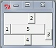
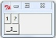
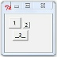
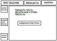
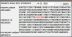
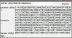

# Дата рождения в π

**Сайт:** https://favorart.github.io/pi-birthday/

Введите дату рождения, и сайт покажет, на каком знаке числа π она встречается впервые.
Это веб-версия десктопного приложения на Tkinter, сделанного когда-то для фестиваля науки.
Ниже — статья о той, первой версии.

## Как устроена веб-версия

| Что | Где |
|---|---|
| Страница | `index.html`, `style.css`, `app.js` — статический сайт для GitHub Pages, сервер не нужен |
| Индекс «дата → позиция» | `data/idx/00.bin … 99.bin`: по файлу на столетие, 100 лет × 372 ячейки × `uint32`, всего ~14,9 МБ. Браузер скачивает только файл нужного столетия (~149 КБ) |
| Цифры π для экрана | не хранятся: берутся из [api.pi.delivery](https://pi.delivery/) (до 1000 цифр за запрос). Первые 3000 знаков лежат в `data/start.txt` |
| Сборка индекса | `tools/build_index.py` |
| Старое приложение | `legacy/pi.py` (Python 2.7, Tkinter) — как было в статье |

Позиция — номер первой цифры даты (`ДДММГГГГ`) после запятой: в `3.1415…` первая `1` имеет номер 1.
Эта нумерация совпадает с `start` в API pi.delivery и со старым приложением.

## Как пересобрать индекс

1. Скачать [y-cruncher](http://www.numberworld.org/y-cruncher/) и посчитать π до 3 000 000 000 знаков
   (Custom Compute → Pi → 3 000 000 000 digits, вывод — **десятичный текст**, не `.ycd`).
   y-cruncher покажет нужный объём памяти. Если он больше RAM, хватит и 2 500 000 000 знаков:
   по оценке все даты встречаются примерно до 1,6–2 млрд.
2. Построить индекс (numpy, несколько минут):
   ```bash
   python tools/build_index.py "Pi - Dec - Chudnovsky.txt" data
   ```
   Скрипт напишет, сколько дат найдено. Сам файл π после этого можно удалить.
3. Закоммитить `data/` и запушить: GitHub Pages обновится сам.

Для проверки без y-cruncher: `python tools/gen_test_digits.py 1000000 pi-1m.txt` считает миллион знаков за минуту.

---
Время от времени встаёт передо мной вопрос о написании небольших оконных приложений. Обычно приложения пишу на С++. Но в своё время вместо Qt изучал WindowsAPI, т.к. окна всегда нужны были для Windows, считаю, что нативный интерфейс всегда лучший. Хочется, чтобы всё смотрелось органично. WinAPI позволяет сделать всё, что может Windows, но много чего приходится писать в коде самому, всегда нужны какие-то плюшки и свистульки.

На WinAPI нельзя мышкой накидать контролы интерфейса, в студии нет дизайнера для этого слоя **:(** (не считая хитрых обходных путей с диалогами вместо форм). Есть, конечно, уровни повыше — MFC и WPF. Но первый имеет очень странную и непростую организацию классов, в которой очень не хочется детально разбираться. А второй прекрасен всем, кроме того, что это C#, т.е. желая писать на С++, нужно использовать managed code и вызывать функции .NET framework.

Бог, с этим всем… Чаще всего проще написать любое приложение на python.

Давайте разберёмся так ли это?

### Tkinter

**Tkinter** – это пакет python, предназначенный для работы с библиотекой Tk, написанной на языке программирования Tcl. Этот пакет просто преобразовывает код python в команды на Tcl.

### Виджет

**Виджет** (**widget**) – элементы интерфейса (Control в терминологии WinAPI) объекты, порожденные встроенными классами.

-   `Button` – кнопка
-   `Entry` – однострочное текстовое поле ввода
-   `Frame` — группа виджетов
-   `Label` – область на окне, в которой может располагаться картинка или статичный текст
-   `Text` – многострочное поле ввода

и др.

Любой граф.интерфейс работает в парадигме событийно-ориентированного программирования, т.е. та или иная часть программного кода начинает выполняться лишь тогда, когда случается то или иное событие.

```
//цикл обработки событий в WinAPI - самая главная функция оконного приложения
LRESULT CALLBACK WndProc(HWND hWnd, UINT messg, WPARAM wParam, LPARAM lParam)
{
    switch (messg)
    {
    case WM_PAINT: //нарисовать окно
      onWindowPaint(hWnd);
      break;
    case WM_DESTROY: //уничтожить окно нажатием на крестик
      PostQuitMessage(0);
      break;
    case WM_ERASEBKGND: //какие-нибудь ещё события
      return 1;
    }
    return DefWindowProc(hWnd, messg, wParam, lParam); //обработка событий по умолчанию самой ОС
}
```

### События

События бывают разными, их может вызывать: таймер, пользователь, система, сами виджеты и пр. Событий очень много, для каждого есть обработчик по умолчанию или пустой. При получении события происходит срабатывание определенной части кода программы. Обычно своя логика в программу добавляется в обработчиках событий.

Минимальное приложение выглядит так:

```
try:
    import tkinter as tk    # >= python 3.0
except ImportError:
    import Tkinter as tk    # >= python 2.7
root = Tk() # создаём главное окно
root.mainloop() # запускаем цикл получения и обработки событий
```

В функции `mainloop()` написан бесконечный цикл. Код, написанный после этой функции выполнится только после выключения приложения. Выход из цикла происходит, например, по событию нажатия на крестик.

Общий план создания GUI-программы:

-   Создать главное окно.
-   Создать доп. окна и виджеты, выполнить их конфигурацию, добавить виджеты на главное или другие окна.
-   Определить интересующие события и их обработчики — то: куда будет вставлен пользовательский код, и как будет реагировать программа.
-   Запустить цикл обработки событий.

### Конфигурация виджетов

Создадим первый виджет — статичный текст в окне, менять который пользователь не сможет

```
tk.Label(root, text="This label")
```

Но текст можно изменять программно, если вместо параметра `text`, подключить строковую переменную, меняя её значение тут же будет меняться и текст на `Label`

```
tk.Label(root, textvariable=lb_text, width=10, font=dFont, anchor=tk.NW)
lb_text = tk.StringVar()
lb_text.set("1")
```

Параметр `font` меняет вид шрифта, я заранее подготовил более крупный читаемый шрифт интерфейса:

```
import tkFont
dFont = tkFont.Font(family="Arial", size=30)
```

Параметр `anchor` определяет выравнивание у виджета — в нашем случае это NORTH-WEST, т.е. текст прижимается к верхнему правому краю виджета.

Устанавливать свойства объектов не обязательно при их создании.

Обратите внимание, что первым аргументом указывается "хозяин", "мастер" – место, где располагается виджет. В данном случае его можно было не указывать,т.к. по умолчанию это `root`. Однако виджеты не обязательно располагаются прямо на главном окне (`root)`, они могут размещаться и в других виджетах.

### Пользовательские обработчики событий

У функций — обработчиков событий, которые вызываются при наступлении события должен быть один параметр. Обычно его называют `event`(событие).

С помощью метода `bind`можно связать обработчик с событием библиотеки Tk:

```
def bt_find_click(event):
    pass
root.bind('<Return>', bt_find_click)
```

Ему передается имя события и вызываемая функция. Событие со всеми его параметрами будет передано в функцию и присвоено аргументу `event`. В данном случае событием является нажатие на клавишу Enter, что обозначается строкой `'<Return>'`.

### Расположение виджетов в окне

Хотя я отчаянно бежал от WinAPI за графическим редактором интерфейса. У Tkinter из коробки его тоже не оказалось **:(** Сжав зубы, я начал читать, как же разработчики без него живут и, на своё удивление, они вышли из положения довольно удобно и элегантно.

### Упаковщики

\[Источник: https://habr.com/post/133337/\]

**1 pack()** — это функция, так называемый упаковщик, или менеджер расположения. Он отвечает за то, как виджеты будут располагаться на главном окне. Для каждого виджета нужно вызвать метод упаковщика, иначе он не будет отображён. Всего упаковщиков три:

pack автоматически размещает виджеты в родительском окне. Имеет параметры:

side – с какого бока добавлять очередной элемент,

fill – растягивать ли его в каком-то направлениях до границ окна,

expand – замостить ли весь родительский объект данным виджетом.

```
from Tkinter import *
root = Tk()
Button(root, text = '1').pack(side = 'left')
Button(root, text = '2').pack(side = 'top')
Button(root, text = '3').pack(side = 'right')
Button(root, text = '4').pack(side = 'bottom')
Button(root, text = '5').pack(fill = 'both')
root.mainloop()
```



**2 grid()** размещает виджеты на сетке. Основные параметры:

row/column – строка/столбец в сетке,

rowspan/columnspan – сколько строк/столбцов занимает виджет.

sticky — как растягивать виджет вместе с увеличением ячейки, в которой он находится: к каким краям ячейки NWSE приклеивать виджет.

```
from Tkinter import *
root = Tk()
Button(root, text = '1').grid(row = 1, column = 1)
Button(root, text = '2').grid(row = 1, column = 2)
Button(root, text = '__3__').grid(row = 2, column = 1, columnspan = 2)
root.mainloop()
```



**3 place()** позволяет размещать виджеты в указанных координатах с указанными размерами. Основные параметры: x, y, width, height.

```
from Tkinter import *
root = Tk()
Button(root, text = '1').place(x = 10, y = 10, width = 30)
Button(root, text = '2').place(x = 45, y = 20, height = 15)
Button(root, text = '__3__').place(x = 20, y = 40)
root.mainloop()
```



Пока Вы не вызвали какой-то упаковщик для виджета, логично, что он не отображается.

### Постановка задачи

Теперь о примере, реализацию которого я хочу Вам рассказать.

Существует гипотеза о том, что число π — [нормальное](http://www.etudes.ru/ru/sketches/normal-number-pi), т.е., что в нём можно найти любую наперёд заданную последовательности из чисел, конечной длины.

Чтобы удивить детей и взрослых на [фестивали науки](http://www.festivalnauki.ru) подглядели вот такой [аттракцион](http://www.etudes.ru/ru/sketches/normal-number-pi/): _вводишь дату своего рождения, а программа говорит на каком символе в строке π её можно найти_.

Соответственно, нужно было посчитать π с точностью до достаточно много знаков, пройтись по всем датам от 1го года Н.Э. до 9999 года Н.Э, и найти их ближайшие смещения в строке π.

### Подсчёт π

Готовая программка по подсчёту π была найдена в [интернетах](http://www.cyberforum.ru/qbasic/thread1923079.html#post10542354 "http://www.cyberforum.ru/qbasic/thread1923079.html#post10542354"). На ней было подсчитано 3 миллиарда знаков после запятой. Получился текстовый файл размером почти 3 Гб.

Далее оказалось, что python 2.7, на котором я обычно пишу программки [не дружит](https://ozymaxx.github.io/blog/2018/05/29/python-strftime "https://ozymaxx.github.io/blog/2018/05/29/python-strftime") с датами до 1900 года. Для перечисления дат была взята библиотека [arrow](http://arrow.readthedocs.io), которая прекрасно справилась:

```
start_date = arrow.Arrow(0001, 1, 1), end_date = arrow.Arrow(9999, 12, 30)
with open('dates.txt', 'w') as dates:
        for single_date in arrow.Arrow.range('day', start_date, end_date): 
            print >>dates, single_date.format(fmt='DDMMYYYY')
```

Был сгенерирован файл со всеми возможными датами с четырёхзначным положительным годом, с учётом високосных и пр.

Далее нужно было записать даты ключами в словарь, пройтись по всем подстрокам π, и значениями в этот словарь записать — смещения, относительно десятичной точки, первых появлений каждой даты.

Оказалось, что python 2.7 также имеет ограничения по величине значения итератора [оператора](https://stackoverflow.com/questions/39470012/python-overflow-error-iter-index-too-large "https://stackoverflow.com/questions/39470012/python-overflow-error-iter-index-too-large") `range()`, код вышел таким:

```
def window(seq, n=2):
    ''' Returns a sliding window (of width n) over data from the iterable
        s -> (s0,s1,...s[n-1]), (s1,s2,...,sn), ... '''
    it = iter(seq)
    result = tuple(islice(it, n))
    if len(result) == n:
        yield result
    for elem in it:
        result = result[1:] + (elem,)
        yield result

def fill_db(db, PI, beg, end, count):
    ''' Put all shifts of dates sub-strings in PI into dictionary db '''
    for i, block in enumerate(window(PI[beg:end],8)):
        s = ''.join(block)
        ddate = "%s.%s.%s" % (s[:2],s[2:4],s[4:])
        if (db.has_key(ddate)):
            if (db[ddate] == ""): count -= 1
            db[ddate] = i+beg
            if (count == 0): break
        if (not (i % 5000000)):
            print '.',

count = len(db)
fill_db(db, PI, 0, 1000000000, count)
fill_db(db, PI, 1000000000, 2000000000, count)
fill_db(db, PI, 2000000000, 3000000000, count)
print
```

Всё, подготовительный этап пройден.

Дело осталось за малым — графический интерфейс.

### Графический интерфейс

План интерфейса следующий:



1.  Зафиксировать минимальный размер окна.
2.  Валидируемый ввод даты, чтобы нельзя было ввести некорректную дату.
3.  Научиться позиционировать текст на `Label`, чтобы он переносился по символам, кроме того, выводилось бы ровно столько текста, сколько помещается на экране.
4.  Оперативная подгрузка из файла и отображение нужной области числа π.
5.  Нужно уметь подсвечивать найденную подстроку среди всех символов.
6.  Размещение объектов. Поместить заголовок из трёх нерастяжимых объектов, а также стальные растяжимые объекты под ними.
7.  Оптимизация работы приложения.

Начнём с простого.

### Минимальный размер окна

```
    root.geometry("1280x640") # размер окна по умолчанию при старте приложения
    root.minsize(680, 340) # минимальный размер окна, чтобы виджеты не схлопывались в точку
```

### Валидация ввода

Для ввода даты был выбран виджет `Entry` (аналог Textbox из WinAPI). Логику ввода только даты Н.Э. решил реализовать самостоятельно через валидацию вводимых символов на лету.

Иллюстрация [общей схемы валидации](https://stackoverflow.com/questions/4140437/interactively-validating-entry-widget-content-in-tkinter "https://stackoverflow.com/questions/4140437/interactively-validating-entry-widget-content-in-tkinter") текстового ввода пользователя в любой виджет библиотеки Tk выглядит следующим образом:

```
class Example(tk.Frame):
    def __init__(self, parent):
        tk.Frame.__init__(self, parent)
        # valid percent substitutions (from the Tk entry man page)
        # note: you only have to register the ones you need; this
        # example registers them all for illustrative purposes
        #
        # %d = Type of action (1=insert, 0=delete, -1 for others)
        # %i = index of char string to be inserted/deleted, or -1
        # %P = value of the entry if the edit is allowed
        # %s = value of entry prior to editing
        # %S = the text string being inserted or deleted, if any
        # %v = the type of validation that is currently set
        # %V = the type of validation that triggered the callback
        #      (key, focusin, focusout, forced)
        # %W = the tk name of the widget
        vcmd = (self.register(self.onValidate),
                '%d', '%i', '%P', '%s', '%S', '%v', '%V', '%W')
        self.entry = tk.Entry(self, validate="key", validatecommand=vcmd)
        self.text = tk.Text(self, height=10, width=40)
        self.entry.pack(side="top", fill="x")
        self.text.pack(side="bottom", fill="both", expand=True)

    def onValidate(self, d, i, P, s, S, v, V, W):
        self.text.delete("1.0", "end")
        self.text.insert("end","OnValidate:\n")
        self.text.insert("end","d='%s'\n" % d)
        self.text.insert("end","i='%s'\n" % i)
        self.text.insert("end","P='%s'\n" % P)
        self.text.insert("end","s='%s'\n" % s)
        self.text.insert("end","S='%s'\n" % S)
        self.text.insert("end","v='%s'\n" % v)
        self.text.insert("end","V='%s'\n" % V)
        self.text.insert("end","W='%s'\n" % W)

        # Disallow anything but lowercase letters
        if S == S.lower():
            return True
        else:
            self.bell()
            return False
# ...
Example(root).pack(fill="both", expand=True)
```

Таким образом, из этого всего, мне нужен был только параметр `'%P'` — _совокупный новый ввод_. Если он целиком, при вводе очередного символа, не является датой, то оставляем то, что было введено до последнего символа, иначе добавляем символ к содержимому `Entry`.

Для полной даты используем ту же самую arrow.

### Настойка виджета числа π

Изначально я планировал использовать статический текст для размещения числа Пи. Он хорошо подходит для тех случаев, когда нужно ограничить пользователей в возможностях выделения, копирования и изменения отображённого текста.

Из коробки `Label` не умеет переносить текст на новые строки по-символьно. Был найден [способ](https://www.reddit.com/r/learnpython/comments/6dndqz/how_would_you_make_text_that_automatically_wraps "https://www.reddit.com/r/learnpython/comments/6dndqz/how_would_you_make_text_that_automatically_wraps") переносить по буквам — длина принудительного переноса устанавливалась равной ширине виджета:

```
class WrappingLabel(tk.Label):
    ''' a type of Label that automatically adjusts the wrap to the size '''
    def __init__(self, master=None, **kwargs):
        tk.Label.__init__(self, master, **kwargs)
        self.bind('<Configure>', lambda e: self.config(wraplength=self.winfo_width()))
# ...
lbt = WrappingLabel(root, textvariable=lbt_text, font=dFont, anchor=tk.NW, justify=tk.LEFT)
```

justify — прижимаем многострочный текст к левому краю `Label`.

Далее нужно было уменьшать предлагаемый к отображению текст в соответствии с объёмом, которой можно отобразить на экране.

Для этого я начал писать новый велосипед с перехватыванием события изменения размеров главного окна:

```
class WrappingLabel(tk.Label):
    ''' a type of Label that automatically adjusts the wrap to the size '''
    def __init__(self, master=None, **kwargs):
        tk.Label.__init__(self, master, **kwargs)
        self.bind('<Configure>', self.fit)         # перехват события вставки и изменения текста
        self.font = tkFont.nametofont(self["font"])                   # получение шрифта виджета
        self.font_height = self.font.metrics('linespace')             # высота шрифта в пикселях
    
    def fit(self, event):
        # ширину виджета в символах получаем из события
        max_width = event.width
        # число строк, влезает по высоте, с учётом шрифта
        max_height = event.height / self.font_height
        # изменённый текст
        text = lbt_text.get()
        # текущая ширина текста в символах
        actual_width = self.font.measure(text)
        # уменьшаем текст, пока он полностью не влезет в виджет
        while (actual_width > (max_width * max_height) and len(text) > 1):
            text = text[:-1]
            actual_width = font.measure(text + "...")
        # запоминаем полученный результат
        lbt_text.set(text + '...')
        # продолжаем переносить по-символьно внутри виджета
        return self.config(wraplength=self.winfo_width())
last_event_H, last_event_W = 0, 0 # старые размеры lbt - высота и ширина
def sizing(event):
    ''' Main window size changing Event handler '''
    global last_event_H, last_event_W
    if (event.width == last_event_W and event.height == last_event_H):
        return # если размер не изменился
    last_event_H, last_event_W = event.height, event.width
    # вызываем событие вручную, для подгонки вставленного текста
    lbt.event_generate("<Configure>", when="now",
                       width=lbt.winfo_width(), height=lbt.winfo_height())
# ...
root.bind("<Configure>", sizing) # соединяем пользовательский обработчик с событием
```

В итоге, пришлось отказаться от виджета `Label`. В первую очередь из-за невозможности подкрашивания найденной подстроки из коробки. Пришлось бы создавать динамический `Label` поверх статического, вычислять координаты положения подстроки в окне, располагать там новый `Label` с новым цветом…

Ох…

### Виджет Text для числа π

Более мощный виджет `Text` c возможностями форматирования областей текста и более тонкой настройкой.

Благодаря п[утеводной нити всех программистов и единственному светлому лучику](http://stackoverflow.com) во тьме и разочаровании всего сущего, где мне подсказали [статью](https://stackoverflow.com/questions/40992931/python-easiest-way-to-define-multiple-global-variables "https://stackoverflow.com/questions/40992931/python-easiest-way-to-define-multiple-global-variables") с аналогичным кейсом, к решению которого я приступил в предыдущем параграфе, а также [документации](https://www.tutorialspoint.com/python/tk_text.htm) к Tkinter, моя мечта осуществилась:

```
class WrappingLabel(tk.Text):
    ''' a type of Text that automatically adjusts the wrap to the size '''
    def __init__(self, master=None, **kwargs):
        tk.Text.__init__(self, master, **kwargs)
        self.bind('<Configure>', self.onFit)
        self.font = tkFont.nametofont(self["font"])
        self.font_height = 46.8 # self.font.metrics('linespace')
    
    def onFit(self, event):
        global LONG_ARRAY, lb_first_text, lb_last_no_text, lb_found_no_text
        max_width = event.width
        max_height = event.height / self.font_height # rough n_lines
        text = LONG_ARRAY
        last = int(lb_last_no_text.get())
        first = int(lb_first_text.get())-1
        actual_width = self.font.measure(text)
        if (actual_width  > max_width * max_height):
            # the original text won't fit. Keep shrinking until it does
            ilast = bisect.bisect_left(KeyList(text, key=lambda x,i: 
                                               self.font.measure(text[:i]+ '...')),
                                               max_width * max_height)
            last = (first + ilast) if (ilast > 0) else last
            text = text[:last-first] + '...'
        self.config(state=tk.NORMAL)
        self.delete(1.0, tk.END)
        self.insert(tk.END, text)
        if (lb_found_no_text.get().isdigit()):
            index = (int(lb_found_no_text.get()) - first - 1)
            self.tag_delete("highlight")
            self.tag_add("highlight", "1."+str(index), "1."+str(index+8))
            self.tag_config("highlight", background=frame["bg"], foreground="red")
        self.config(state=tk.DISABLED)
        lb_last_no_text.set(str(last))
        return True
# ...
lbt = WrappingLabel(frame, font=dFont, wrap=tk.CHAR, bg=frame["bg"], fg='black')
```

Идея осталась та же с перехватом события изменения текста, улучшилась её реализация. Несколько пунктов.

1.  Вместо while по всем буквам начиная с последней — бинарный поиск.

```
if (actual_width  > max_width * max_height):
    # the original text won't fit. Keep shrinking until it does
    ilast = bisect.bisect_left(KeyList(text, key=lambda x,i: 
                                       self.font.measure(text[:i]+ '...')),
                                       max_width * max_height)
```

Т.к. бинарный поиск не имеет параметра `предикат` вычисления ключа, по которому нужно сортировать, пришлось написать `обёртку`.

```
class KeyList(object):
    ''' bisect doesn't accept a key function, so we build the key into our sequence '''
    def __init__(self, l, key):
        self.l = l
        self.key = key
    def __len__(self):
        return len(self.l)
    def __getitem__(self, index):
        return self.key(self.l[index], index)
```

Вместо буквы — подставляет поиску длину от начала до неё самой.

2\. Вместо точной высоты шрифта подобрал коэффициент, из-за переносов на новые строки — ширина умноженная на высоту — всё же не точный размер.

```
self.font_height = 46.8   # вместо self.font.metrics('linespace')
```

Коэффициент максимально близко располагает конец текста к концу виджета, но, конечно, иногда ошибается:


3\. `Text` умеет переносить побуквенно сам.

```
wrap=tk.CHAR
```

4\. `Text` умеет подсвечивать собственные подстроки. Подсветка найденной подстроки в красный цвет:

```
self.tag_add("highlight", "1."+str(index), "1."+str(index+8))
self.tag_config("highlight", background=frame["bg"], foreground="red")
```

5\. Запрещаем любую модификацию этого виджета:

```
lb3.config(state=tk.DISABLED)
```

Чтобы `Text` не выделялся, как и`Label`, зданий фон — `background` — делаем таким же, как цвет главного окна:

```
bg=frame["bg"]
```

Добавляем некоторые начальные данные в `Text` при старте программы:

```
LONG_ARRAY = read_pi(1,2500) 
lb3.insert(tk.END, LONG_ARRAY)
```

Заменяем данные на нужные в обработчике события:

```
self.delete(1.0, tk.END)   # сначала удаляют старые данные, начиная с 0го символа 1й строки,
self.insert(tk.END, text)  # затем вставляю новые данные в строку в конец текста
```

Как можно видеть данные добавляются не также, как в `Label`, можно добавлять построчно, указывая в какую строку записывать. Я не стал с этим запариваться, работаю лишь с одной строкой.

В кой-то веке что-то было сделано встроенными средствами, что уже является _большой победой_.

Код поиска в базе дат, выполняющийся по клику на кнопку «Найти» или по нажатию Enter, выполнен следующим образом:

```
def bt_find_click(event=None):
    global LONG_ARRAY, FN_LOG_DATES, DB
    global lb_first_text, lb_last_no_text, lb_found_no_text, lb3
    # размещаем в Тексте хоть сколько-то символов Пи
    first, last = 1, 2500
    # получаем введённую дату
    ddate = tb_date.get()
    if (not DB.has_key(ddate)): # если дата не введена пользователем
        lb_found_no_text.set("--")
    else:
        # получаем смещение этой даты относительно десятичной точки
        index = int(DB[ddate])
        # получаем число отображённых символов в текущий момент в Тексте
        last = int(lb_last_no_text.get()) - int(lb_first_text.get())
        # вычисляем случайное положение найденной подстроки для отображения в окне
        last_of = random.randint(9, 100) if (last > 100) else 9
        offset = random.randint(10, last - last_of)
        # вычисляем начало и конец отображаемого фрагмента числа Пи
        first = (index - offset) if (index > offset) else 1
        last = index + last
        # отображаем смещение найденной даты в соответствующем для этого виджете
        lb_found_no_text.set(str(index))
    # отображаем новые границы показанного фрагмента Пи в нужных виджетах
    lb_first_text.set(str(first))
    lb_last_no_text.set(str(last))
    # считываем нужный фрагмент Пи из файла
    LONG_ARRAY = read_pi(first, last-first)
    
    lb3.config(state=tk.NORMAL)        # разрешаем редактирование Текста
    lb3.event_generate("<Configure>",             # здесь мы собственноручно вызываем событие
                       when="now",                # прямо сейчас
                       width=lb3.winfo_width(),   # и задаём параметры аргумента Event, а именно
                       height=lb3.winfo_height()) # актуальную ширину и высоту самого виджета
    lb3.config(state=tk.DISABLED)      # запрещаем редактирование
```

Как можно видеть, чтобы модифицировать теперь `Text` даже программно нужно возвращать его сначала в нормальное состояние, менять содержимое, а потом снова отключать возможность модификации.

Случайное смещение добавлено для того, чтобы явно выделить: для новой даты подсвеченное совпадение является правильным и находится в другом (возможно далёком) фрагменте числа Пи.

Своего рода оптимизацией является то, что подгружается только маленький нужный фрагмент числа Пи. Но при этом считывание происходит быстро и не вызывает задержек в интерфейсе. Хранить в памяти весь огромный файл Пи и считывать его во время старта программы было бы сильным расточительством.

```
def read_pi(first,last):
    global FN_PI_STRING
    with open(FN_PI_STRING, 'r') as f_pi:
        if (first == 1):
            f_pi.seek(1)
            PI = "3."+f_pi.read(last)
        else:
            f_pi.seek(first)
            PI = f_pi.read(last)
    return PI
```

### Размещение объектов

Изначально, думал, делать программу с помощью первого самого простого упаковщика — `pack()`. Согласно плану для этого нужно было объединить объекты в группы, чтобы правильно растянуть основной `Text` в размер окна.

Во-первых, выделил в группу `Frame` головную часть из трёх объектов окна: приглашение, ввод-даты и кнопку — `win_header`.

```
# ...
win_header = tk.Frame(root, padx=10, pady=2)
# padx и pady - задал отступы для расположения элементов внутри группы
win_header.pack(side=tk.TOP, fill=tk.X)
# добавить группу на главное окно со стороны верха (TOP)
# растянуть по горизонтали (Х) на всю ширину окна
# добавляем в группу Приглашение слева
lb_invite = tk.Label(win_header, text="Input your birth date", font=dFont,
                     anchor=tk.NW, width=20)
lb_invite.pack(side=tk.LEFT)
# добавляем в группу Entry сразу за Приглашением слева
lb_date = DateEntry(win_header, font=dFont)
lb_date.pack(side=tk.LEFT)
# кнопку прикрепляем справа
bt_find = tk.Button(win_header, text="Find", font=dFont, command=bt_find_click, pady=2)
bt_find.pack(side=tk.RIGHT)
# ...
```

Во-вторых, потребовались группы: основной части `win_body` и внутри неё группа левой колонки `winbl` с тремя номерами символов: первого показанного, начала найденной подстроки с датой и последнего показанного.

```
# ...
win_body = tk.Frame(root)
win_body.pack(side=tk.TOP, fill=tk.BOTH)
# растягиваем группу в оба направления: вертикальное и горизонтальное 
# слева добавляем группу - колонку с номерами символов
winbl = tk.Frame(win_body, width=10)
winbl.pack(side=tk.LEFT, fill=tk.BOTH)
# задаём виджет для номера первого показанного символа
lb_first_no = tk.Label(winbl, textvariable=lb_first_no_text, font=dFont, anchor=tk.NW, width=10)
lb_first_no.pack(side=tk.TOP, fill=tk.X)
# задаём виджет для номера символа начала найденной подстроки
lb_found_no = tk.Label(winbl, textvariable=lb_found_no_text, font=dFont, anchor=tk.NW, width=10)
# задаём виджет для номера последнего показанного символа
lb_last_no = tk.Label(winbl, textvariable=lb_last_no_text, font=dFont, anchor=tk.NW, width=10)
lb_last_no.pack(side=tk.BOTTOM, fill=tk.X)
# задаём основной виджет для отображённого фрагмента числа Пи
lb_digits = WrappingLabel(win_body, textvariable=lb_digits_text, font=dFont,
                          anchor=tk.NW, justify=tk.LEFT)
lb_digits.pack(side=tk.TOP, expand=True, fill=tk.BOTH)
# Растягиваем (expand) этот виджет на всё свободное место в группе,
# а саму группу растягиваем (fill), на всё свободное место в окне
# ...
```

Но позднее распробовал упаковщик grid() и сделал всё с помощью него.

### Табличный упаковщик

Создал группу `frame` для всех виджетов главного окна, в которой наметил виртуальных 11 столбцов и 7 строк.

Прикинул так — приглашение, ввод-даты и кнопка должны находится в первой строке, при том приглашение должно занимать 4 столбца, ввод-даты идти прямо за ним и занимать 3 столбца, а кнопка должна быть справа и занимать 2 столбца. Разрешил расширяться (sticky) вместе с ячейками, которые они занимают, во всех направлениях.

```
frame = tk.Frame(root)
tk.Grid.rowconfigure(root, 0, weight=1)
tk.Grid.columnconfigure(root, 0, weight=1)
frame.grid(row=0, column=0, sticky=tk.NSEW)
# Приглашение
lb_invite = tk.Label(frame, text="Input your birth date", font=dFont, anchor=tk.NW)
lb_invite.grid(column=0, row=0, columnspan=4, sticky=tk.NSEW, pady=0, padx=10) 
# Ввод-даты
tb_date = DateEntry(frame, font=dFont)
tb_date.grid(column=4, row=0, columnspan=3, sticky=tk.NSEW, pady=10)
# Кнопка
bt_find = tk.Button(frame, text="Find", font=dFont, command=bt_find_click)
bt_find.grid(column=8, row=0, columnspan=2, sticky=tk.NSEW, pady=0)
```

Остальные элементы расставил по аналогии. Как видно, `Text` — `lbt` занимает больше всего места:

```
# задаём виджет для номера первого показанного символа
lb_first = tk.Label(frame, textvariable=lb_first_text, width=10)
lb_first.grid(column=0, row=2, sticky=tk.NSEW)
# задаём виджет для номера символа начала найденной подстроки
lb_found_no = tk.Label(frame, textvariable=lb_found_no_text)
lb_found_no.grid(column=0, row=4, sticky=tk.NSEW)
# задаём виджет для номера последнего показанного символа
lb_last_no = tk.Label(frame, textvariable=lb_last_no_text)
lb_last_no.grid(column=0, row=6, sticky=tk.NSEW)
# задаём основной виджет для отображённого фрагмента числа Пи
lbt = WrappingLabel(frame)
lbt.grid(column=1, row=1, columnspan=9, rowspan=5, sticky=tk.NSEW)
```

В самом конце установил веса ячеек, чем больше вес, тем сильнее она будет изменять свой размер при масштабировании главного окна.

```
for y in range(1,11): tk.Grid.columnconfigure(frame, y, weight=1)
for x in range(2,6): tk.Grid.rowconfigure(frame, x, weight=1)
```

### Оптимизация работы программы

Когда всё было написано и отлажено, лёгкое тестирование выявило, что старт программы происходил непростительно долго. Всё это из-за чтения текстового файла.

Хотя удалось избавиться от необходимости считывания файла Пи. Избежать полного считывания базы дат из файла не получится. Она представляет собой таблицу с двумя стобцами — подстрока даты — таб — число-смещение.

Стало быть надо понять — как её считать быстро. Простой эксперимент:

```
from timeit import default_timer as timer
def read_db():
    global FN_DB_DATES
       
    t = timer()
    db = {}
    with open(FN_DB_DATES, 'r') as f:
        pairs = [ line.split('\t') for line in f ]
        db = { k:v for k,v in pairs }
    elapsed = timer() - t
    print "{} {:.10f} secs.".format("readfile", elapsed)
    
    db1 = {}
    t = timer()
    with open(FN_DB_DATES, mode='r') as infile:
        db1 = dict(row[:2] for row in csv.reader(infile, delimiter="\t"))
    elapsed = timer() - t
    print "{} {:.10f} secs.".format("csv file", elapsed)
    
    t = timer()
    db2 = pd.read_csv(FN_DB_DATES, header=None, delimiter="\t", 
                      dtype={'a':str,'b':str}).set_index(0).squeeze().to_dict()
    elapsed = timer() - t
    print "{} {:.10f} secs.".format("pd  file", elapsed)
    
    t = timer()
    db3 = {row[0] : row[1] for row in pd.read_csv(FN_DB_DATES).iterrows()}
    elapsed = timer() - t
    print "{} {:.10f} secs.".format("pd csvrd", elapsed)
    
    t = timer()
    db4 = { k:v for k,v in loadtxt(FN_DB_DATES, delimiter="\t",
                                   dtype={'names': ('date', 'offset'), 'formats': ('S','S')}) }
    elapsed = timer() - t
    print "{} {:.10f} secs.".format("loadtxt ", elapsed)
    return db
```

Замеры времени проводились timeit - стандартными средствами python.

Результаты следующие:

```
readfile 6.3322045118 secs.
csv file 4.1212712648 secs.
pd  file 4.4932071859 secs.
pd csvrd 350.0057260714 secs.
loadtxt  41.6930684601 secs.
```

Оставляем csv. Всё равно долго.

Тогда я подкатил тяжёлую артиллерию — многопоточность — считывание текстового файла с датами в фоне, пока загружается форма.

```
# определяем поток, который будет читать текстовый файл
class Worker(threading.Thread):
    ''' thread to read the dates DB from the text file '''
    def run(self):
        global DB
        DB = read_db()
WORKER = Worker() # создаём экземпляр этого потока, который считывает БД из файла 
```

Для такого случая, что при программировании окон довольно частый — когда хотят, чтобы форма не зависала при производстве сложных вычислений, у библиотеки Tk есть специальный функции. Нас интересует `after()`, которая умеет вызывать через 10 секунд работы цикла событий нашу функцию, здесь `listen_for_result()`.

```
def listen_for_result():
    """ Check if there is something load """
    global WORKER, root
    WORKER.join(1)
    if WORKER.is_alive():
        root.after(10, listen_for_result)

if __name__ == '__main__':
    # ...
    WORKER.start()
    root.after(10, listen_for_result)
    # ...
    root.mainloop()
```

Которая пробует завершить поток, если он закончил работу, и если ещё нет, снова ставит Tk на ожидание на 10 секунд.

Таким образом, параллельно загрузке окна, что тоже тяжеловесная операция происходит загрузка немаленького текстового файла. _Победа_.

осталось одно но, но если пользователь ввёл дату раньше, чем считался файл - что может быть очень врядли, но всё же, ждём, пока закончится работа потока, потом производим поиск в готовой БД:

```
def bt_find_click(event=None):
    # ...
    if WORKER.is_alive():
        WORKER.join()
    # ...
```

### Полный исходный текст программы

```
#!/usr/bin/env python
# -*- coding: utf-8 -*-
import os
import io
import re
import sys
import csv
import arrow
import random
import bisect
import threading
import Tkinter as tk

try:
    import tkinter as tk    # >= python 3.0
except ImportError:
    import Tkinter as tk    # >= python 2.7
import tkFont

LOCAL_STRINGS = {} # перевод программы на разные языки
FN_PI_STRING = '' # имя файла с предпосчитанными 3 млрд. знаками числа Пи
FN_LOG_DATES = ''
FN_DB_DATES = '' # имя файла БД с расположением дат в строке Пи
LONG_ARRAY = '' # массив для сохранения подстроки Пи, которая отображена в окне
DB = {} # словарь БД дат-смещений

class Worker(threading.Thread):
    ''' thread to read the dates DB from the text file '''
    def run(self):
        global DB
        DB = read_db()
WORKER = Worker()

class DateEntry(tk.Frame):
    ''' Entry to input validated date only '''
    def __init__(self, master, frame_look={}, **look):
        args = dict(relief=tk.SUNKEN, border=1)
        args.update(frame_look)
        tk.Frame.__init__(self, master, **args)
        args = {'relief': tk.FLAT}
        args.update(look)
        vcmd = (self.register(self.onValidate), '%P')
        self.entry = tk.Entry(self, validate="key", validatecommand=vcmd,  **args)
        self.entry.pack(side=tk.TOP, fill=tk.X)
    
    def get(self):
        return self.entry.get()
    
    def onValidate(self, P):
        if (len(P) > 10):
            self.bell()
            return False
        if (len(P) == 1 and P[0] not in '0123'):
            self.bell()
            return False
        if (len(P) > 1 and (not P[1].isdigit() or \
            (P[0] == P[1] and P[1] == '0') or int(P[:2]) > 31)):
            self.bell()
            return False
        if (len(P) > 2 and P[2] != '.'):
            self.bell()
            return False
        if (len(P) > 3 and P[3] not in '01'):
            self.bell()
            return False
        if (len(P) > 4):
            if (not P[4].isdigit() or (P[3] == P[4] and P[4] == '0') or int(P[3:5]) > 12):
                self.bell()
                return False
            if (int(P[:2]) > 29 and P[3:5] == '02'):
                self.bell()
                return False
            if (int(P[:2]) == 31 and P[3:5] in ['04', '06', '09', '11']):
                self.bell()
                return False        
        if (len(P) > 5 and P[5] != '.'):
            self.bell()
            return False
        if (len(P) > 6 and not P[6:].isdigit()):
            self.bell()
            return False
        if (len(P) == 10):
            try:
                splt = P.split('.')
                valid = arrow.Arrow(int(splt[2]),int(splt[1]),int(splt[0]))
            except ValueError:
                self.bell()
                return False
        return True

class KeyList(object):
    ''' bisect doesn't accept a key function, so we build the key into our sequence '''
    def __init__(self, l, key):
        self.l = l
        self.key = key
    def __len__(self):
        return len(self.l)
    def __getitem__(self, index):
        return self.key(self.l[index], index)

class WrappingLabel(tk.Text):
    ''' a type of Text that automatically adjusts the wrap to the size '''
    def __init__(self, master=None, **kwargs):
        tk.Text.__init__(self, master, **kwargs)
        self.bind('<Configure>', self.onFit)
        self.font = tkFont.nametofont(self["font"])
        self.font_height = 46.8 # self.font.metrics('linespace')
    
    def onFit(self, event):
        global LONG_ARRAY, lb_first_text, lb_last_no_text, lb_found_no_text
        max_width = event.width
        max_height = event.height / self.font_height # rough n_lines
        text = LONG_ARRAY
        last = int(lb_last_no_text.get())
        first = int(lb_first_text.get())-1
        actual_width = self.font.measure(text)
        if (actual_width  > max_width * max_height):
            # the original text won't fit. Keep shrinking until it does
            ilast = bisect.bisect_left(KeyList(text, key=lambda x,i: 
                                               self.font.measure(text[:i]+ '...')), 
                                               max_width * max_height)
            last = (first + ilast) if (ilast > 0) else last
            text = text[:last-first] + '...'
        self.config(state=tk.NORMAL)
        self.delete(1.0, tk.END)
        self.insert(tk.END, text)
        if (lb_found_no_text.get().isdigit()):
            index = (int(lb_found_no_text.get()) - first - 1)
            self.tag_delete("highlight")
            self.tag_add("highlight", "1."+str(index), "1."+str(index+8))
            self.tag_config("highlight", background=frame["bg"], foreground="red")
        self.config(state=tk.DISABLED)
        lb_last_no_text.set(str(last))
        return True

def bt_find_click(event=None):
    global LONG_ARRAY, FN_LOG_DATES, DB
    global lb_first_text, lb_last_no_text, lb_found_no_text, lb3
    first, last = 1, 2500
    if WORKER.is_alive():
        WORKER.join()
    ddate = tb_date.get()
    if (not DB.has_key(ddate)):
        lb_found_no_text.set("--")
    else:
        index = int(DB[ddate])
        with open(FN_LOG_DATES, 'a') as f_log:
            print >>f_log, ddate
        last = int(lb_last_no_text.get()) - int(lb_first_text.get())
        last_of = random.randint(9, 100) if (last > 100) else 9
        offset = random.randint(10, last - last_of)
        first = (index - offset) if (index > offset) else 1
        last = index + last
        lb_found_no_text.set(str(index))
    lb_first_text.set(str(first))
    lb_last_no_text.set(str(last))
    LONG_ARRAY = read_pi(first,last-first)
    lb3.config(state=tk.NORMAL)
    lb3.event_generate("<Configure>", when="now",
                       width=lb3.winfo_width(), height=lb3.winfo_height())
    lb3.config(state=tk.DISABLED)
    return

def read_pi(first,last):
    global FN_PI_STRING
    with open(FN_PI_STRING, 'r') as f_pi:
        if (first == 1):
            f_pi.seek(1)
            PI = "3."+f_pi.read(last)
        else:
            f_pi.seek(first)
            PI = f_pi.read(last)
    return PI

def read_config():
    global FN_LOG_DATES, FN_PI_STRING, FN_DB_DATES, LOCAL_STRINGS
    with open('config.txt', 'r') as f:
        config = { line.split('=')[0].strip():
                   line.split('=')[1].strip().strip('"') for line in f }
    FN_LANGUAGE = os.path.join(config["lang_dir"],config["language"])
    FN_LOG_DATES = config["log_dates"]
    FN_PI_STRING = config["pi_string"]
    FN_DB_DATES = config["db_file"]
    with io.open(FN_LANGUAGE, 'r', encoding='utf-8') as f:
        LOCAL_STRINGS = { line.split('=')[0].strip():
                          line.split('=')[1].strip().strip('"') for line in f }
    return

def read_db():
    global FN_DB_DATES
    with open(FN_DB_DATES, mode='r') as infile:
        db = dict(row[:2] for row in csv.reader(infile, delimiter="\t"))
    return db

def listen_for_result():
    ''' Check if there is something load '''
    global WORKER, root
    WORKER.join(1)
    if WORKER.is_alive():
        root.after(10, listen_for_result)

if __name__ == '__main__':
    read_config()
    LONG_ARRAY = read_pi(1,2500)
    root = tk.Tk()
    root.geometry("1280x640")
    root.minsize(680, 340)
    WORKER.start()
    root.after(10, listen_for_result)
    root.bind('<Return>', bt_find_click)
    dFont=tkFont.Font(family="Arial", size=30)
    root.grid_columnconfigure(0, weight=1)
    frame = tk.Frame(root)
    tk.Grid.rowconfigure(root, 0, weight=1)
    tk.Grid.columnconfigure(root, 0, weight=1)
    frame.grid(row=0, column=0, sticky=tk.NSEW)
    lb_invite = tk.Label(frame, text=LOCAL_STRINGS["invitation"], font=dFont, anchor=tk.NW)
    lb_invite.grid(column=0, row=0, columnspan=4, sticky=tk.NSEW, pady=0, padx=10)
    tb_date = DateEntry(frame, font=dFont)
    tb_date.grid(column=4, row=0, columnspan=3, sticky=tk.NSEW, pady=10)
    tb_date.bind('<Return>', bt_find_click)
    bt_find = tk.Button(frame, text=LOCAL_STRINGS["button_name"], font=dFont,
                        command=bt_find_click)
    bt_find.grid(column=8, row=0, columnspan=2, sticky=tk.NSEW, pady=0)
    lb_first1 = tk.Label(frame, text=LOCAL_STRINGS["lb1"], font=dFont, anchor=tk.SW)
    lb_first1.grid(column=0, row=1, sticky=tk.NSEW)
    lb_first_text = tk.StringVar()
    lb_first_text.set("1")
    lb_first = tk.Label(frame, textvariable=lb_first_text, width=10, font=dFont, anchor=tk.NW)
    lb_first.grid(column=0, row=2, sticky=tk.NSEW)
    lb_found1 = tk.Label(frame, text=LOCAL_STRINGS["lb2"], font=dFont, anchor=tk.SW)
    lb_found1.grid(column=0, row=3, sticky=tk.NSEW)
    lb_found_no_text = tk.StringVar()
    lb_found_no_text.set("--")
    lb_found_no = tk.Label(frame, textvariable=lb_found_no_text, font=dFont, anchor=tk.NW)
    lb_found_no.grid(column=0, row=4, sticky=tk.NSEW)
    lb_last1 = tk.Label(frame, text=LOCAL_STRINGS["lb3"], font=dFont, anchor=tk.SW)
    lb_last1.grid(column=0, row=5, sticky=tk.NSEW)
    lb_last_no_text = tk.StringVar()
    lb_last_no_text.set("2500")
    lb_last_no = tk.Label(frame, textvariable=lb_last_no_text, font=dFont, anchor=tk.NW)
    lb_last_no.grid(column=0, row=6, sticky=tk.NSEW)
    lb_last_digit_text = tk.StringVar()
    lb_last_digit_text.set("")
    lb_last_digit = tk.Label(frame, textvariable=lb_last_digit_text, font=dFont, anchor=tk.NW)
    lb_last_digit.grid(column=1, row=6, columnspan=9, rowspan=1, sticky=tk.NSEW)  
    lb3_text = tk.StringVar() 
    lb3 = WrappingLabel(frame, font=dFont, wrap=tk.CHAR, bg=frame["bg"], fg='black')
    lb3.grid(column=1, row=1, columnspan=9, rowspan=5, sticky=tk.NSEW)
    for y in range(1,11):
        tk.Grid.columnconfigure(frame, y, weight=1)
    for x in range(2,6):
        tk.Grid.rowconfigure(frame, x, weight=1)
    lb3.insert(tk.END, LONG_ARRAY)
    lb3.config(state=tk.DISABLED)
    tb_date.focus_set()
    root.mainloop()
```



### Локализация

Вместо статичных строк, строки считываются из файла конфигурации.



### Исполняемый файл

Осталось скомпилировать в .exe — это делается с помощью консольной команды (если у Вас на компьютере стоит anaconda):

```
pyinstaller --onefile pi.py --noconsole
```

noconsole — Tk запускается из консоли, то перед запуском формы показывается терминал, который нам не нужен, убираем его данным параметром.

### Все файлы и код

[https://cloud.mail.ru/public/81Ua/5GEoX3doW](https://cloud.mail.ru/public/81Ua/5GEoX3doW)

### Использованная литература:

-   https://stackoverflow.com/questions/30257574/how-to-get-the-widgets-current-x-and-y-coordinates
-   https://docs.python.org/2.7/library/ttk.html#label-options
-   https://www.tcl.tk/man/tcl/TkCmd/event.htm
-   https://stackoverflow.com/questions/3842155/is-there-a-way-to-make-the-tkinter-text-widget-read-only
-   http://effbot.org/tkinterbook/text.htm
-   https://www.tutorialspoint.com/python/tk\_text.htm
-   https://www.tutorialspoint.com/python/tk\_button.htm
-   https://www.tutorialspoint.com/python/tk\_entry.htm
-   https://www.tutorialspoint.com/python/tk\_frame.htm
-   https://www.tutorialspoint.com/python/tk\_label.htm
-   https://www.tutorialspoint.com/python/tk\_pack.htm
-   https://www.tutorialspoint.com/python/tk\_grid.htm
-   https://stackoverflow.com/questions/52062162/python-tkinter-how-to-count-the-quantity-of-characters-can-be-shown-in-expandi/52066664#52066664
-   http://zetcode.com/gui/tkinter/layout/
-   https://stackoverflow.com/questions/3950687/how-to-find-out-the-current-widget-size-in-tkinter
-   https://stackoverflow.com/questions/4140437/interactively-validating-entry-widget-content-in-tkinter
-   http://effbot.org/tkinterbook/label.htm
-   http://effbot.org/tkinterbook/text.htm
-   https://www.reddit.com/r/learnpython/comments/6dndqz/how\_would\_you\_make\_text\_that\_automatically\_wraps/
-   https://stackoverflow.com/questions/25936958/tkinter-entry-validation-not-working
-   http://effbot.org/tkinterbook/variable.htm
-   http://infohost.nmt.edu/tcc/help/pubs/tkinter/web/entry-validation.html
-   https://stackoverflow.com/questions/13242970/tkinter-entry-box-formatted-for-date
-   https://stackoverflow.com/questions/51143777/display-three-dots-in-the-end-of-a-tkinter-label-text
-   https://stackoverflow.com/questions/42146482/using-bisect-on-list-of-tuples-but-compare-using-first-value-only
-   http://effbot.org/tkinterbook/tkinter-events-and-bindings.htm
-   https://stackoverflow.com/questions/48726956/measure-the-height-of-a-string-in-tkinter-python
-   https://stackoverflow.com/questions/270648/tkinter-invoke-event-in-main-loop
-   https://arrow.readthedocs.io/en/latest/#arrow.arrow.Arrow
-   https://docs.python.org/2/library/bisect.html
-   https://www.tutorialspoint.com/python/file\_seek.htm
-   https://stackoverflow.com/questions/4140437/interactively-validating-entry-widget-content-in-tkinter
-   https://stackoverflow.com/questions/10624937/convert-datetime-object-to-a-string-of-date-only-in-python
-   https://stackoverflow.com/questions/14288498/creating-a-loop-for-two-dates/14288620
-   https://stackoverflow.com/questions/39470012/python-overflow-error-iter-index-too-large
-   https://scorython.wordpress.com/2016/06/27/multithreading-with-tkinter/
-   https://stackoverflow.com/questions/42589372/pythontkinter-how-to-run-in-background-independant-of-tk-frontend
-   https://docs.python.org/2/library/threading.html
-   http://www.cyberforum.ru/qbasic/thread1923079.html#post10542354
