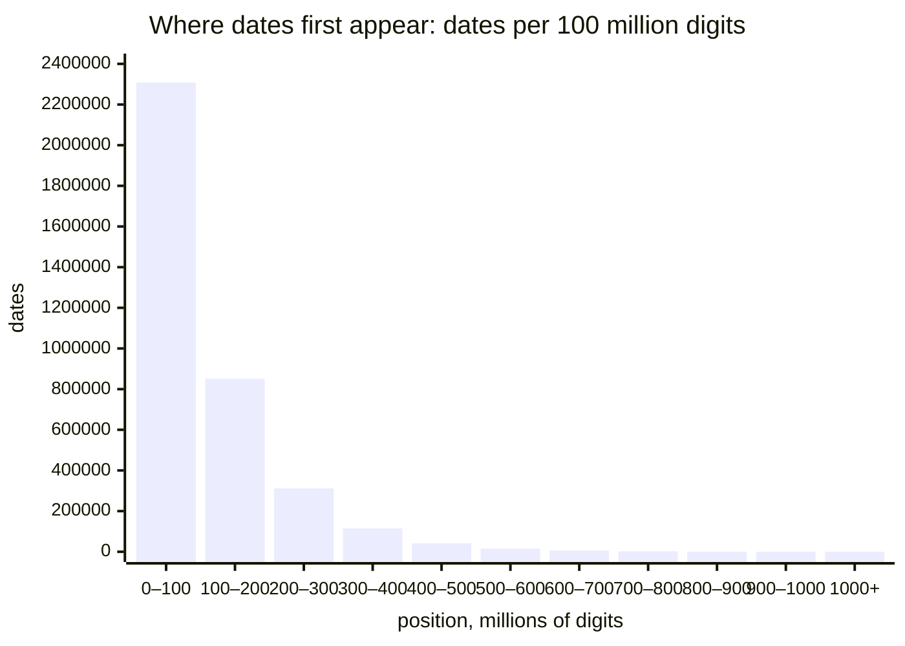
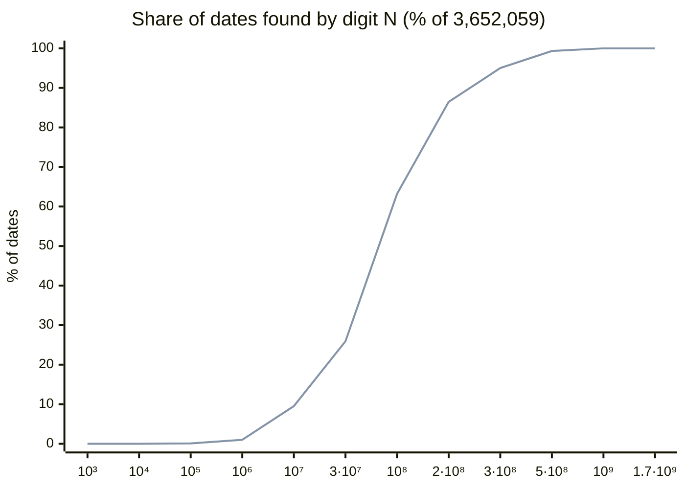
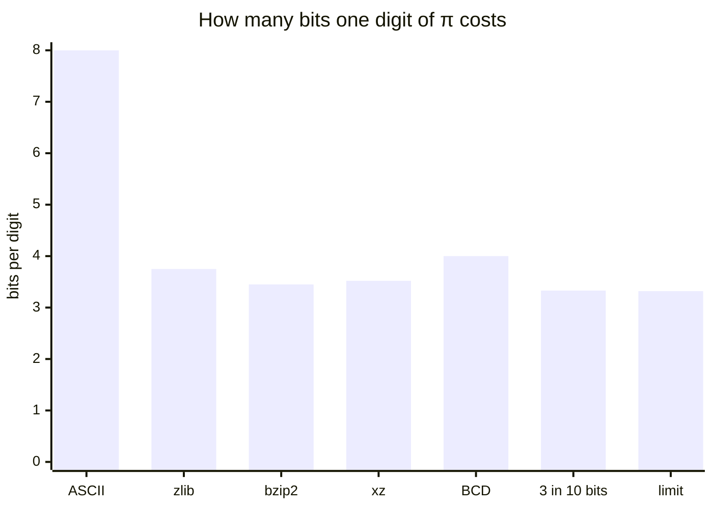
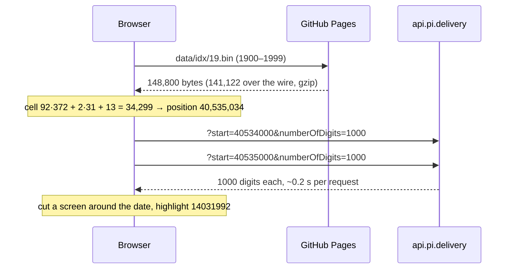
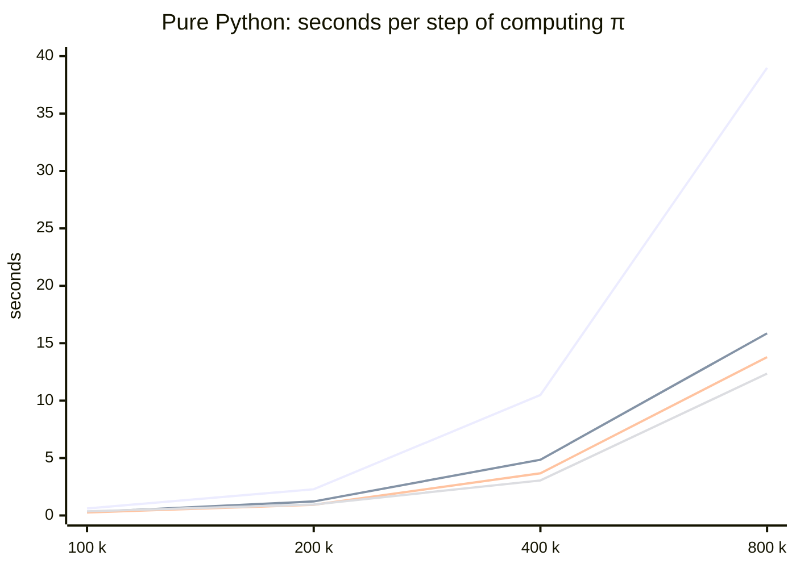
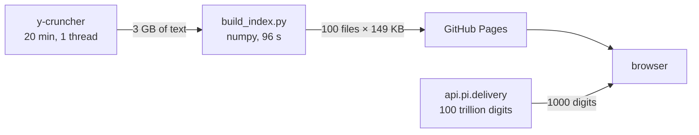

# Three billion digits of π you don't need to store

_Is every finite string of digits really written somewhere among the endless digits of π?_\
_And so every calendar date, too?_\
_Which date shows up in π first, and which one hides the deepest?_\
_And how do you find your birthday without storing a single digit of π?_

~~With benchmarks and charts.~~ In pictures, for the little ones.

[Русская версия](article-2026.ru.md)

---

## Is everything really in π?

[π](https://en.wikipedia.org/wiki/Pi) is the ratio of a circle's circumference to its diameter, 3.14159265… Its digits after the point never end and never fall into a loop. [Lambert](https://en.wikipedia.org/wiki/Johann_Heinrich_Lambert) proved that back in 1761: π is an [irrational number](https://en.wikipedia.org/wiki/Irrational_number).

Mathematicians believe π is a [normal number](https://en.wikipedia.org/wiki/Normal_number). That means every digit appears in it once in ten times, every pair of digits once in a hundred, every eight digits once in a hundred million. As if someone had rolled the digits of π on a fair ten-sided die!

If that's true, then π contains every finite string of digits. Your phone number. Your credit card number. The text of this article in any encoding. A real [Library of Babel](https://en.wikipedia.org/wiki/The_Library_of_Babel) from Borges, only infinite.

Is it true? Most likely, yes: tests on trillions of digits agree with normality. But there is no proof. Nobody has even proved that the digit 7 appears in π infinitely many times!

## We can't prove it. But can we feel it?

Any date can be written as eight digits in a row: 14.03.1992 becomes `14031992`. There are a hundred million different eight-digit strings, so a particular date turns up in π roughly once per hundred million digits. Print a hundred million digits and you get a hundred volumes of 330 pages each. One bookshelf wall -- and your birthday is somewhere in it!

Open https://favorart.github.io/pi-birthday/, type in your child's date of birth and press "Find". In the middle of a wall of digits their birthday lights up in red, with its position on the left. My own birthday, 14.03.1992 -- yes, on [Pi Day](https://en.wikipedia.org/wiki/Pi_Day) -- turned up at digit 40,535,034 after the decimal point.

From here on the child asks the questions. What about mum's date? Dad's? Is there a date that isn't in π? (Spoiler: there isn't.) Which one hides the deepest?

## So how does it work?

In 2018 my program (offline) needed a 3 GB file: three billion digits of π. Plus a "date → position" table that took 4 seconds to load!

Now I wanted readers to be able to run the same experiment themselves, so I turned the old program into a web page on GitHub Pages. But the process turned out to be so much fun that it grew into a new article.

Because the site didn't need the file of digits at all! How did that happen?

## 1. How many digits of π do you actually need?

In 2018 I computed 3 billion digits "just in case". How many were actually needed? There are **3,652,059** dates from 01.01.0001 to 31.12.9999. On average you have to wait 10⁸ digits for each one, but "on average" is misleading here. The position of a string's first appearance is almost [exponentially distributed](https://en.wikipedia.org/wiki/Exponential_distribution): half of the dates are found by position 10⁸ · ln 2 ≈ 69 million, but the tail stretches far.

This is what it looks like on the real digits of π. Almost all dates gather in the first few hundred million digits, followed by a long, thinning tail:

The same picture as a running total:

_Two lines -- the fact and the formula 1 − e^(−N/10⁸). They differ by less than 0.1 percentage points, so the chart shows just one._

What matters is not the average but the **latest** of 3.65 million dates. The maximum of N exponential variables equals, on average, the mean times the [harmonic number](https://en.wikipedia.org/wiki/Harmonic_number) H_N ≈ ln N + 0.577. For our dates that is 10⁸ · 15.69 ≈ **1.57 billion digits**.

My "just in case" turned out to be an almost twofold margin.

## 2. Maybe π can be compressed?

First thought: 3 GB of text made of nothing but digits will surely compress. I compressed the first 10 million digits and multiplied the result by 300, since for random digits the compression ratio doesn't depend on length:

| Method | 3 billion digits | Bits per digit | Direct access to digit N |
|---|---|---|---|
| ASCII text | 3.00 GB | 8 | yes |
| zlib -9 | 1.41 GB | 3.75 | no |
| bzip2 -9 | 1.29 GB | 3.45 | no |
| xz (lzma -9) | 1.32 GB | 3.52 | no |
| 2 digits per byte ([BCD](https://en.wikipedia.org/wiki/Binary-coded_decimal)) | 1.50 GB | 4 | yes |
| 3 digits in 10 bits | 1.250 GB | 3.33 | yes |
| Theoretical limit | 1.246 GB | log₂10 ≈ 3.32 | -- |

Compressors look for repetitions, and π has none. Each digit appears almost exactly 10 % of the time (from 999,333 to 1,001,093 times per 10 million), and the next one doesn't depend on the previous ones. All a compressor can do is throw away the spare bits of the ASCII code. Dumb packing of "three digits into 10 bits" (1000 values out of 1024) does that too, and better, faster and without losing direct access: the address of digit N is a formula.

Bottom line: no compressor will squeeze 3 billion digits below **1.25 GB**. And GitHub Pages has a [limit](https://docs.github.com/en/pages/getting-started-with-github-pages/github-pages-limits) of 1 GB for the whole site. Dead end.

## 3. What if we store only what's on the screen?

The screen never shows 3 billion digits anyway. I opened a screenshot of the 2018 program and counted: 11 lines, ten with 42 digits and the last with 40. That's **460 digits** per screen, 8 of which are the date itself, which needn't be stored.

So for every date we could store a window of 452 digits around it:

| Window around the date | Digits per date | Total for 3.65 million dates |
|---|---|---|
| ±20 | 40 | 76 MB |
| ±50 | 100 | 167 MB |
| ±100 | 200 | 319 MB |
| 2018 screen | 452 | **~700 MB** |

It fits, but only just, and every site update turns into uploading hundreds of megabytes. And if you want to show the date at a random spot on the screen, like the original did, the window doubles to 1.4 GB.

## 4. What if we don't store π at all?

Someone already stores the digits of π. In 2022 Google Cloud [computed 100 trillion digits](https://cloud.google.com/blog/products/compute/calculating-100-trillion-digits-of-pi-on-google-cloud) -- the world record at the time -- and serves them through an API: [`api.pi.delivery`](https://pi.delivery/) returns up to 1000 digits per request, with [CORS](https://en.wikipedia.org/wiki/Cross-origin_resource_sharing), for free. So the site only needs to know one thing: **where** to look.

The index becomes trivial: for every date one 32-bit number -- the digit after the decimal point where the date starts. 3 billion fits into 32 bits (4.29 billion), so 4 bytes per date.

The layout is 100 files, one per century. Inside: 100 years × 12 months × 31 days × 4 bytes = **148,800 bytes**. A date's address is a single formula, no searching at all: cell number = year within the century × 372 + (month − 1) × 31 + (day − 1). You pay for it with empty cells for 30 February, 31 April and other days that don't exist: 67,941 of them, 1.8 % of the index.

2018 and 2026 side by side:

| | 2018, desktop | 2026, browser |
|---|---|---|
| Digits of π | 3 GB on disk | 0 bytes, taken from the API |
| Date table | text, ~74 MB, 4.1 s to read | 14.9 MB on the server |
| Downloaded per date | -- | 141 KB of index + ~2 KB of digits |
| Startup | background thread so the window doesn't freeze | instant |

### Can the index itself be compressed?

The [entropy](https://en.wikipedia.org/wiki/Entropy_(information_theory)) of the positions is about 28 bits out of 32, so the most you can win is 12 %. Compressors squeeze out 3–6 %, and GitHub Pages already serves files gzipped, so I didn't bother inventing my own format.

## 5. How do you compute 3 billion digits on a laptop?

In 2018 I found a [little program](http://www.cyberforum.ru/qbasic/thread1923079.html#post10542354) on a forum, started it and waited. This time I decided to first check what plain Python can do.

The [Chudnovsky formula](https://en.wikipedia.org/wiki/Chudnovsky_algorithm) gives about 14 digits per term and fits into 30 lines of pure Python ([gen_test_digits.py](https://github.com/favorart/pi-birthday/blob/main/tools/gen_test_digits.py)). It computes 800 thousand digits in 81 seconds. Not bad? Except that every doubling of the digits costs four times the time:

_Lines from top to bottom: the final division, conversion to a string, the square root, the series itself._

The series itself is the cheapest part! The longest step is one single division at the very end. Division, square root and string conversion of big integers in CPython 3.8 use schoolbook, quadratic algorithms. String conversion is so slow that in 2022 it was declared a vulnerability -- [CVE-2020-10735](https://nvd.nist.gov/vuln/detail/CVE-2020-10735), its number reserved back in 2020. Since Python 3.11 a number longer than 4300 digits simply refuses to be printed by default.

Now let's multiply. Three billion is 3,750 times more than 800 thousand, and squaring that gives a factor of 14 million. In pure Python my laptop would be computing π for **about 36 years**. The best compressor for π is 30 lines of code. Decompression takes 36 years.

So I took [y-cruncher](http://www.numberworld.org/y-cruncher/), the program used to set world records for π. Even in its humblest mode (one thread, 4 GB of RAM, the rest on disk) it computed 3 billion digits in **20 minutes**.

In the 81 seconds Python spends on 800 thousand digits, y-cruncher produces about 240 million.

There were two stumbles. At first the computation crashed with "Unknown Error 3": the path to the temporary files went over 260 characters ([MAX_PATH](https://learn.microsoft.com/en-us/windows/win32/fileio/maximum-file-path-limitation)). And a control run for one billion I started during the day, left, and came back three and a half hours later. CPU idle, y-cruncher hanging and politely asking whether to really continue with 0.4 GB of free memory out of 16. At night, when the 3 billion were computed, the laptop was free and y-cruncher asked nothing. Three gigabytes of digits are ready. Now find 3.65 million dates in them.

## 6. How do you find 3.65 million dates in 3 billion digits?

The 2018 program walked through π with an 8-digit window: at every step it glued the digits into a "DD.MM.YYYY" string and looked it up in a dictionary. I measured this approach on 2 million digits (on Python 3 already): 0.53 million digits per second, about 54 minutes for the whole pass.

And Python 2.7 added its own twist. The position counter when iterating over a string was stored in a 32-bit number -- on Windows even in a 64-bit build -- and at the 2.1 billion mark the program crashed with "iter index too large". The file of digits had to be cut into pieces of a billion.

In 2026 the same job is done by [numpy](https://numpy.org/), and not one position at a time, but whole arrays at once. Eight copies of the digit array, shifted by 0…7 positions, are added up so that every position immediately gets the eight-digit number DDMMYYYY. A table of 10⁸ flags says whether it is a real date, and numpy finds the first occurrence of each date by itself.

That's 18 million digits per second, 33 times faster than the 2018 approach. It needs about 0.5 GB of memory: two tables of 10⁸ elements plus a 50-million-digit chunk of π. The whole pass took **96 seconds** and stopped by itself, long before the end of the file: there was nothing left to look for.

## 7. So what turned up?

All 3,652,059 dates were found. And π behaved exactly as the theory of random digits predicts:

| | Theory | Fact |
|---|---|---|
| Mean position | 100,000,000 | 99,930,807 |
| Median | 69,314,718 | 69,274,900 |
| Latest date | ~1,568,800,000 | 1,669,501,859 |
| Earliest date | ~27 | 63 |

The forecast from section 1 missed the latest date by 6 %, but for a single record that is within the spread. Mean positions per century lie in the 98.0–101.6 million corridor: π neither favours nor slights any era. The charts in section 1 show the same across the whole distribution: fact and formula coincide.

A few records and curiosities:

- **The earliest** is 23.07.8164, at digit 63: `…5923078164…`. The first thousand digits hold only 33 dates, the first million 36,303, that is 1 %.
- **The latest** is 12.02.6987, at digit **1,669,501,859**. Whoever is born on that day will have to wait the longest: both to be born and for their digit. Runners-up: 17.02.9995 (1.50 billion) and 10.03.6087 (1.46 billion).
- **01.01.1970**, the start of the [Unix epoch](https://en.wikipedia.org/wiki/Unix_time), is at digit 6,297,536. **01.01.2000** is at 181,946,674, while millennium eve **31.12.1999** is all the way at 498,894,645.
- **11.11.1111** has the longest expected wait in theory. The string `11111111` overlaps with itself, and its expected waiting time is not 10⁸ but 111,111,110 (the sum of 10ᵏ over all k where the start of the string matches its end -- [Conway's "leading numbers"](https://en.wikipedia.org/wiki/Penney%27s_game)). It turned up at digit 159,090,113 -- later than average, but one date proves nothing. Its relatives `12121212` and `10101010` (12.12.1212 and 10.10.1010) overlap every two digits and wait on average 1 % longer than an ordinary date; 12.12.1212, for instance, was found as early as digit 88,168,706.

## 8. So what's the bottom line?

π didn't have to be stored at all: the site only knows where to look and takes the digits from Google.

Of all the computations in the project, the most expensive one now is 20 minutes of a single laptop core. And only once.

And still nobody has proved that π is normal. But 3,652,059 dates differed from the theory of random digits by less than a tenth of a percent. That won't become a proof, but believing in the infinite library is much easier now.

Which date would you check first? Find it here: https://favorart.github.io/pi-birthday/
