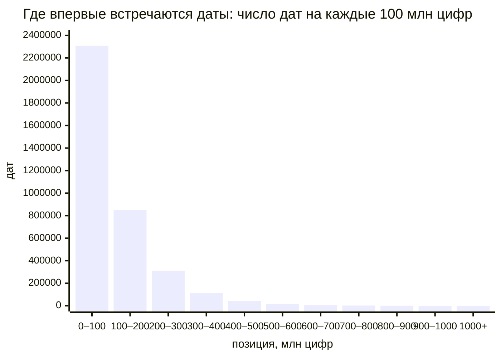
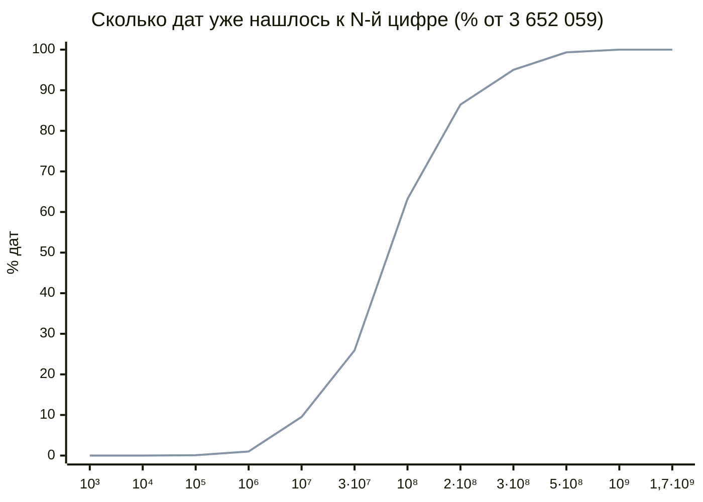
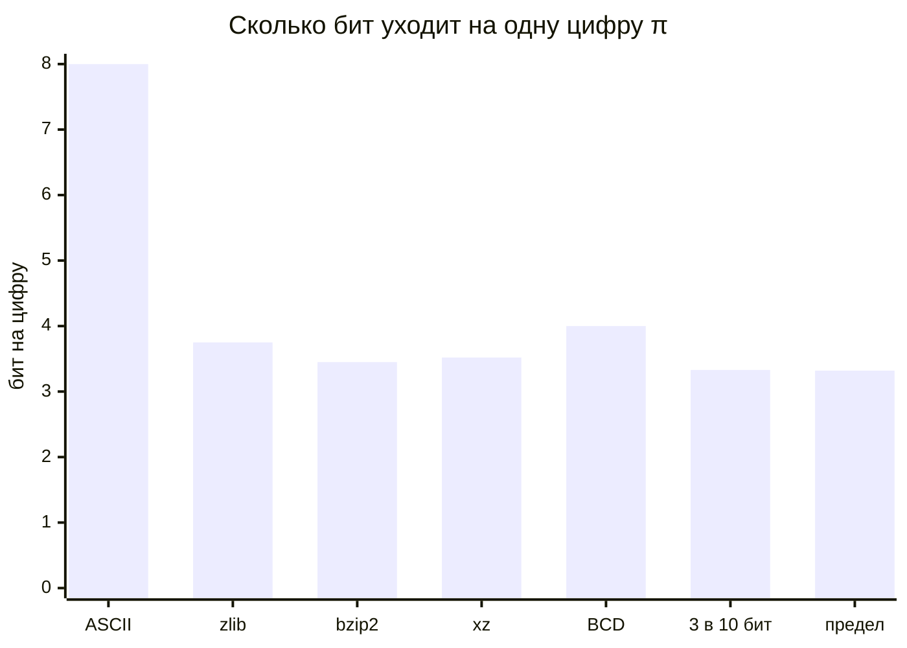
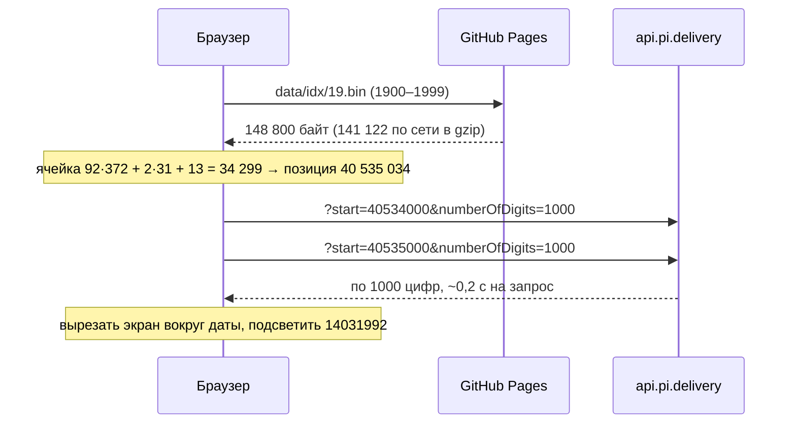
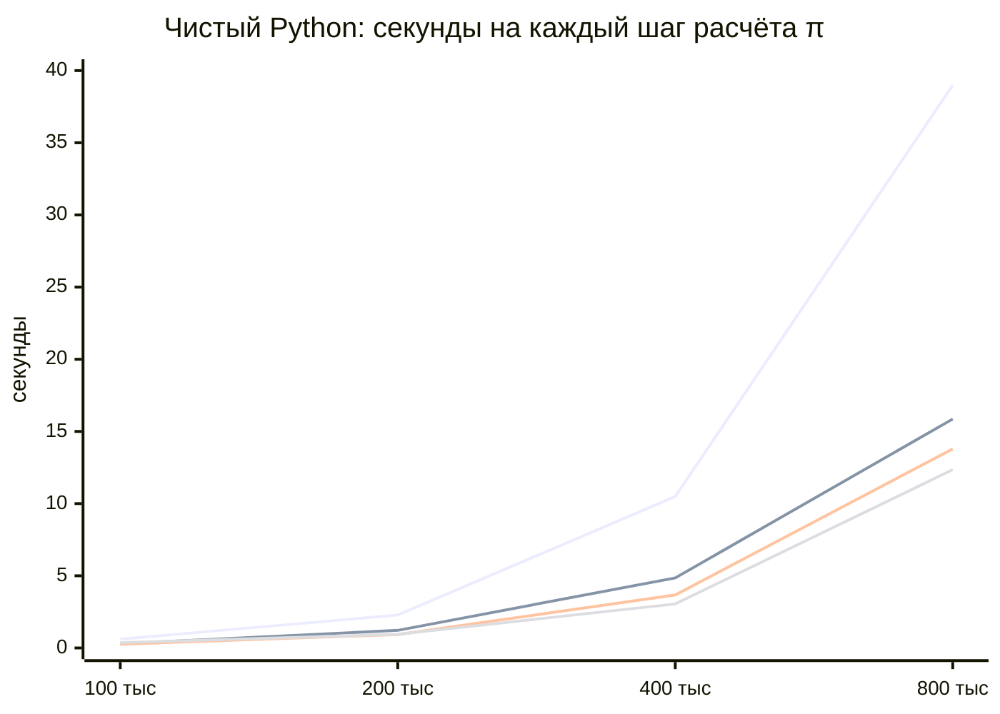
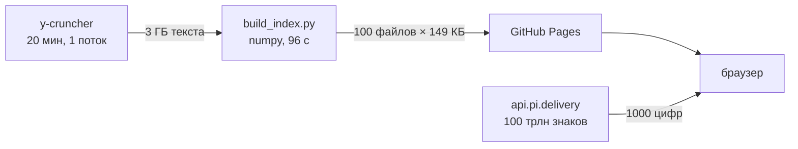

# Три миллиарда знаков π, которые не нужно хранить

_Правда ли, что среди бесконечных знаков числа π записана любая цепочка цифр?_\
_А значит, и любая дата календаря?_\
_Какая дата встречается в π раньше всех, а какая прячется глубже всех?_\
_И как найти вашу дату рождения, не храня ни одной цифры π?_

~~С замерами и графиками.~~ В картинках для самых маленьких.

[English version](article-2026.md)

---

## Правда ли, что в π есть всё?

Число [π](https://ru.wikipedia.org/wiki/Пи_(число)) -- отношение длины окружности к её диаметру, 3,14159265… Его знаки после запятой не кончаются и никогда не зацикливаются. Это доказал ещё [Ламберт](https://ru.wikipedia.org/wiki/Ламберт,_Иоганн_Генрих) в 1761 году: π -- [иррациональное число](https://ru.wikipedia.org/wiki/Иррациональное_число).

Математики верят, что π -- [нормальное число](https://ru.wikipedia.org/wiki/Нормальное_число). Это значит, что каждая цифра встречается в его записи в одном случае из десяти, каждая пара цифр -- в одном из ста, каждая восьмёрка -- в одном из ста миллионов. Как будто цифры π кто-то выбрасывал на честном десятигранном кубике!

Если это так, то в π записана любая конечная цепочка цифр. Ваш номер телефона. Ваш номер кредитной карточки. Текст этой статьи в любой кодировке. Настоящая [Вавилонская библиотека](https://ru.wikipedia.org/wiki/Вавилонская_библиотека) Борхеса, только бесконечная.

Правда ли это? Скорее всего, да: проверки на триллионах знаков с нормальностью согласны. Но доказательства нет. Не доказано даже, что семёрка встречается в π бесконечно много раз!

## Доказать не получается. А как это почувствовать?

Любую дату можно записать восемью цифрами подряд: 14.03.1992 превращается в `14031992`. Разных восьмёрок цифр -- сто миллионов, значит, конкретная дата попадается в π примерно раз на сто миллионов знаков. Напечатайте сто миллионов цифр -- выйдет сто томов по 330 страниц. Одна книжная стенка -- и ваш день рождения где-то в ней!

Откройте https://favorart.github.io/pi-birthday/, введите дату рождения ребёнка и нажмите «Найти». Посреди стены цифр красным загорится его день рождения, а слева -- номер места. Мой день рождения, 14.03.1992 -- да, в [День числа π](https://ru.wikipedia.org/wiki/День_числа_пи), -- нашёлся на 40 535 034-й цифре после запятой.

Дальше вопросы будет задавать уже ребёнок. А мамина дата? А папина? А есть дата, которой в π нет? (Спойлер: такой нет.) А какая спрятана глубже всех?

## А как это устроено?

В 2018 году моей программе (без интернета) нужен был файл на 3 ГБ: три миллиарда знаков π. И ещё таблица «дата → позиция», которая грузилась 4 секунды!

Сегодня я захотел, чтобы читатели статьи могли провести тот же эксперимент сами, и перевёл старую программку в веб-форму на GitHub Pages. Но процесс оказался настолько увлекательным, что из него выросла новая статья.

Ведь сайту файл с цифрами оказался не нужен вовсе! Как так вышло?

## 1. Сколько знаков π нужно на самом деле?

В 2018-м я посчитал 3 млрд знаков «на всякий случай». А сколько было нужно? Дат с 01.01.0001 по 31.12.9999 -- **3 652 059**. Каждую в среднем приходится ждать 10⁸ знаков, но «в среднем» тут обманчиво. Момент первого появления строки распределён почти [экспоненциально](https://ru.wikipedia.org/wiki/Экспоненциальное_распределение): половина дат находится уже к позиции 10⁸ · ln 2 ≈ 69 млн, зато хвост тянется далеко.

Так это выглядит на настоящих цифрах π. Почти все даты собираются в первые сотни миллионов знаков, а дальше идёт длинный, редеющий хвост:

Та же картина нарастающим итогом:

_Две линии -- факт и формула 1 − e^(−N/10⁸). Расходятся они меньше чем на 0,1 процентного пункта, поэтому на графике видна одна._

Нас интересует не среднее, а **самая поздняя** из 3,65 млн дат. Максимум из N экспоненциальных величин в среднем равен среднему, умноженному на [гармоническое число](https://ru.wikipedia.org/wiki/Гармоническое_число) H_N ≈ ln N + 0,577. Для наших дат это 10⁸ · 15,69 ≈ **1,57 млрд знаков**.

Мой «всякий случай» оказался почти двукратным запасом.

## 2. Может, π можно сжать?

Первая мысль: 3 ГБ текста из одних цифр уж точно сожмутся. Я сжал первые 10 млн знаков и умножил результат на 300, ведь у случайных цифр степень сжатия от длины не зависит:

| Способ | 3 млрд цифр | Бит на цифру | Прямой доступ к N-й цифре |
|---|---|---|---|
| Текст ASCII | 3,00 ГБ | 8 | да |
| zlib -9 | 1,41 ГБ | 3,75 | нет |
| bzip2 -9 | 1,29 ГБ | 3,45 | нет |
| xz (lzma -9) | 1,32 ГБ | 3,52 | нет |
| 2 цифры в байте ([BCD](https://ru.wikipedia.org/wiki/Двоично-десятичный_код)) | 1,50 ГБ | 4 | да |
| 3 цифры в 10 битах | 1,250 ГБ | 3,33 | да |
| Теоретический предел | 1,246 ГБ | log₂10 ≈ 3,32 | -- |

Архиваторы ищут повторы, а в π их нет. Каждая цифра встречается почти ровно в 10 % случаев (от 999 333 до 1 001 093 раз на 10 млн), и следующая не зависит от предыдущих. Архиватору остаётся только выкинуть лишние биты из ASCII-кода. С этим справляется и тупая упаковка «три цифры в 10 бит» (1000 вариантов из 1024), причём лучше, быстрее и без потери прямого доступа: адрес N-й цифры вычисляется формулой.

Итог: 3 млрд знаков меньше **1,25 ГБ** не сожмёт ни один архиватор. А у GitHub Pages [лимит](https://docs.github.com/en/pages/getting-started-with-github-pages/github-pages-limits) на весь сайт -- 1 ГБ. Тупик.

## 3. А если хранить только то, что видно на экране?

На экране всё равно не 3 млрд цифр. Я открыл скриншот программы 2018 года и посчитал: 11 строк, в десяти по 42 цифры и в последней 40. Итого **460 цифр** на экран, из них 8 -- сама дата, которую хранить не надо.

Значит, можно для каждой даты хранить окно в 452 цифры вокруг неё:

| Окно вокруг даты | Цифр на дату | Всего на 3,65 млн дат |
|---|---|---|
| ±20 | 40 | 76 МБ |
| ±50 | 100 | 167 МБ |
| ±100 | 200 | 319 МБ |
| экран 2018 года | 452 | **~700 МБ** |

Влезает, но впритык, и каждое обновление сайта превращается в заливку сотен мегабайт. А если захочется показывать дату в случайном месте экрана, как в оригинале, окно удваивается до 1,4 ГБ.

## 4. А что, если не хранить π вообще?

Цифры π уже кто-то хранит. В 2022 году Google Cloud [посчитал 100 триллионов знаков](https://cloud.google.com/blog/products/compute/calculating-100-trillion-digits-of-pi-on-google-cloud) -- тогдашний мировой рекорд -- и раздаёт их через API: [`api.pi.delivery`](https://pi.delivery/) отдаёт до 1000 цифр за запрос, с [CORS](https://ru.wikipedia.org/wiki/Cross-origin_resource_sharing), бесплатно. Значит, сайту нужно знать только одно: **где** искать.

Индекс получается тривиальным: для каждой даты одно 32-битное число -- номер цифры после запятой, с которой дата начинается. 3 млрд влезают в 32 бита (4,29 млрд), так что 4 байта на дату.

Раскладка -- 100 файлов, по одному на столетие. Внутри: 100 лет × 12 месяцев × 31 день × 4 байта = **148 800 байт**. Адрес даты вычисляется одной формулой, без всякого поиска: номер ячейки = год внутри столетия × 372 + (месяц − 1) × 31 + (день − 1). Платить за это приходится пустыми ячейками для 30 февраля, 31 апреля и прочих несуществующих дней: их 67 941, 1,8 % индекса.

2018 и 2026 рядом:

| | 2018, десктоп | 2026, браузер |
|---|---|---|
| Цифры π | 3 ГБ на диске | 0 байт, берутся из API |
| Таблица дат | текст, ~74 МБ, чтение 4,1 с | 14,9 МБ на сервере |
| Скачивается на одну дату | -- | 141 КБ индекса + ~2 КБ цифр |
| Старт | фоновый поток, чтобы окно не висло | мгновенно |

### А сам индекс сжать можно?

[Энтропия](https://ru.wikipedia.org/wiki/Информационная_энтропия) позиций -- около 28 бит из 32, так что выиграть можно максимум 12 %. Архиваторы выжимают 3–6 %, а GitHub Pages и так отдаёт файлы в gzip, поэтому городить свой формат я не стал.

## 5. Как посчитать 3 млрд знаков на ноутбуке?

В 2018-м я нашёл на форуме [программку](http://www.cyberforum.ru/qbasic/thread1923079.html#post10542354), запустил и ждал. В этот раз решил сначала проверить, на что способен голый Python.

[Формула Чудновского](https://ru.wikipedia.org/wiki/Алгоритм_Чудновского) даёт около 14 знаков за член ряда и пишется на чистом Python за 30 строк ([gen_test_digits.py](https://github.com/favorart/pi-birthday/blob/main/tools/gen_test_digits.py)). 800 тысяч знаков она считает за 81 секунду. Неплохо? Только каждое удвоение знаков стоит вчетверо больше времени:

_Линии сверху вниз: финальное деление, перевод в строку, квадратный корень, сам ряд._

Сам ряд -- самая дешёвая часть! Дольше всего одно-единственное деление в конце. Деление, корень и перевод в строку у больших чисел в CPython 3.8 работают школьными, квадратичными алгоритмами. Перевод в строку настолько медленный, что в 2022 году его признали уязвимостью -- [CVE-2020-10735](https://nvd.nist.gov/vuln/detail/CVE-2020-10735), номер зарезервировали ещё в 2020-м. С Python 3.11 число длиннее 4300 цифр по умолчанию просто отказываются печатать.

Теперь умножим. Три миллиарда -- это в 3 750 раз больше, чем 800 тысяч, а квадрат даёт множитель в 14 миллионов. На чистом Python мой ноутбук считал бы π **около 36 лет**. Лучший архиватор π -- 30 строк кода. Распаковка -- 36 лет.

Поэтому я взял [y-cruncher](http://www.numberworld.org/y-cruncher/), программу, которой ставят мировые рекорды по π. Даже в самом скромном режиме (один поток, 4 ГБ памяти, остальное на диск) 3 млрд знаков она посчитала за **20 минут**.

За те 81 секунду, что Python тратит на 800 тысяч знаков, y-cruncher выдаёт около 240 миллионов.

Подножек было две. Сначала расчёт падал с «Unknown Error 3»: путь к временным файлам перевалил за 260 символов ([MAX_PATH](https://learn.microsoft.com/en-us/windows/win32/fileio/maximum-file-path-limitation)). А контрольный замер на миллиард я поставил днём, ушёл и вернулся через три с половиной часа. Процессор не занят, y-cruncher висит и вежливо спрашивает, точно ли продолжать при 0,4 ГБ свободной памяти из 16. Ночью, когда считались 3 миллиарда, ноутбук был свободен, и y-cruncher ни о чём не спрашивал. Три гигабайта цифр готовы. Осталось найти в них 3,65 млн дат.

## 6. Как найти 3,65 млн дат в 3 млрд цифр?

Программа 2018 года шла по π окном в 8 цифр: на каждом шаге склеивала из них строку «ДД.ММ.ГГГГ» и искала её в словаре. Я замерил этот подход на 2 млн цифр (уже на Python 3): 0,53 млн цифр в секунду, на весь проход -- около 54 минут.

А Python 2.7 добавлял своё. Счётчик позиции при обходе строки там хранился в 32-битном числе -- на Windows даже в 64-битной сборке, -- и на отметке 2,1 млрд программа падала с ошибкой «iter index too large». Файл с цифрами приходилось резать на куски по миллиарду.

В 2026-м то же самое делает [numpy](https://numpy.org/), и не по одной позиции, а целыми массивами. Восемь копий массива цифр, сдвинутых на 0…7 позиций, складываются так, что в каждой позиции сразу получается восьмизначное число ДДММГГГГ. Таблица из 10⁸ флажков отвечает, настоящая ли это дата, а первое вхождение каждой даты numpy находит сам.

Выходит 18 млн цифр в секунду, в 33 раза быстрее подхода 2018 года. Памяти нужно около 0,5 ГБ: две таблицы по 10⁸ элементов плюс кусок π в 50 млн цифр. Весь проход занял **96 секунд** и остановился сам, задолго до конца файла: искать стало нечего.

## 7. Так что же нашлось?

Все 3 652 059 дат нашлись. И π повело себя ровно так, как предсказывает теория случайных цифр:

| | Теория | Факт |
|---|---|---|
| Средняя позиция | 100 000 000 | 99 930 807 |
| Медиана | 69 314 718 | 69 274 900 |
| Самая поздняя дата | ~1 568 800 000 | 1 669 501 859 |
| Самая ранняя дата | ~27 | 63 |

Прогноз из первого раздела промахнулся по самой поздней дате на 6 %, но для одного-единственного рекорда это в пределах разброса. Средние позиции по столетиям лежат в коридоре 98,0–101,6 млн: π не любит и не обижает ни одну эпоху. Графики из первого раздела показывают то же самое на всём распределении: факт и формула совпадают.

Немного рекордов и курьёзов:

- **Раньше всех** -- 23.07.8164, на 63-й цифре: `…5923078164…`. В первой тысяче знаков всего 33 даты, в первом миллионе -- 36 303, то есть 1 %.
- **Позже всех** -- 12.02.6987, на **1 669 501 859-й** цифре. Тем, кто родится в этот день, придётся ждать дольше всех: и рождения, и своей цифры. За ней 17.02.9995 (1,50 млрд) и 10.03.6087 (1,46 млрд).
- **01.01.1970**, начало [эпохи Unix](https://ru.wikipedia.org/wiki/Unix-время), -- на 6 297 536-й цифре. **01.01.2000** -- на 181 946 674-й, а канун миллениума **31.12.1999** -- аж на 498 894 645-й.
- **11.11.1111** по теории ждёт дольше всех. Строка `11111111` перекрывается сама с собой, и среднее время до первого появления у неё не 10⁸, а 111 111 110 (сумма 10ᵏ по всем k, где начало строки совпадает с концом -- [«ведущие числа» Конвея](https://en.wikipedia.org/wiki/Penney%27s_game)). Нашлась она на 159 090 113-й цифре -- позже среднего, но по одной дате ничего не докажешь. Её родственницы `12121212` и `10101010` (12.12.1212 и 10.10.1010) перекрываются через две цифры и ждут в среднем на 1 % дольше обычной даты; 12.12.1212, например, нашлась уже на 88 168 706-й.

## 8. Что в итоге?

Хранить π не пришлось вовсе: сайт знает только, где искать, а цифры берёт у Google.

Из всех вычислений проекта дороже всего теперь 20 минут одного ядра ноутбука. И то один раз.

А нормальность π так никто и не доказал. Но 3 652 059 дат разошлись с теорией случайных цифр меньше чем на десятую долю процента. Доказательством это не станет, зато поверить в бесконечную библиотеку теперь гораздо проще.

А какую дату вы бы проверили первой? Найти её можно здесь: https://favorart.github.io/pi-birthday/
