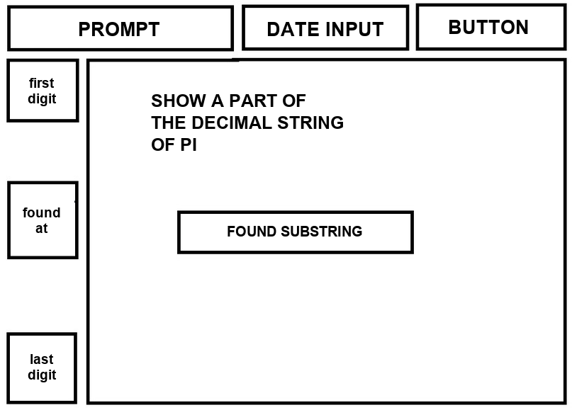
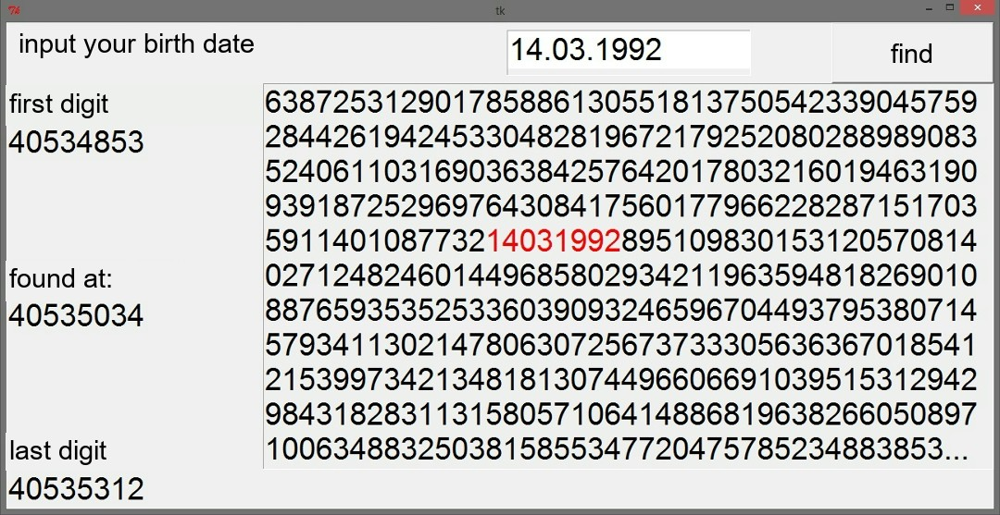

# A GUI application in Python

**English** · [Русский](article.ru.md)

_A 2018 article about the first, desktop version (Python 2.7 + Tkinter), translated from Russian. Original publication: [VK](https://vk.ru/@33453621-pi-gui-python). Full code: [legacy/pi.py](legacy/pi.py); to run it today, use [legacy/run.sh](legacy/run.sh)._

_The 2026 sequel, a web version that stores no digits of π: [π stores everything, so I didn't have to store π](article-2026.md)._

Every now and then I need to write a small windowed application. I usually write applications in C++. Back in the day, instead of Qt I learned the Windows API, since my windows were always for Windows, and I believe a native interface is always the best one. I want everything to look organic. WinAPI lets you do anything Windows can do, but a lot has to be written by hand, and there are always some bells and whistles you need.

With WinAPI you cannot drag-and-drop controls with the mouse; Visual Studio has no designer for that layer **:(** (apart from tricky workarounds using dialogs instead of forms). There are higher levels, of course — MFC and WPF. But the first has a very strange and complicated class organization that I really don't want to dig into. And the second is great in every way except that it is C#: if you want to write in C++, you have to use managed code and call .NET framework functions.

Oh well… Most of the time it is easier to write any application in Python.

Let's see whether that is true.

### Tkinter

**Tkinter** is a Python package for working with the Tk library, written in the Tcl programming language. The package simply translates Python code into Tcl commands.

### Widgets

A **widget** is an interface element (a Control in WinAPI terms): an object created from the built-in classes.

-   `Button` – a button
-   `Entry` – a single-line text input
-   `Frame` – a group of widgets
-   `Label` – an area of the window that can hold an image or static text
-   `Text` – a multi-line text input

and others.

Any GUI follows the event-driven programming paradigm: a given piece of code runs only when a certain event happens.

```c
// the event loop in WinAPI - the most important function of a windowed application
LRESULT CALLBACK WndProc(HWND hWnd, UINT messg, WPARAM wParam, LPARAM lParam)
{
    switch (messg)
    {
    case WM_PAINT: // paint the window
      onWindowPaint(hWnd);
      break;
    case WM_DESTROY: // destroy the window when the close button is clicked
      PostQuitMessage(0);
      break;
    case WM_ERASEBKGND: // some other events
      return 1;
    }
    return DefWindowProc(hWnd, messg, wParam, lParam); // default handling by the OS itself
}
```

### Events

Events come in many kinds: they can be triggered by a timer, the user, the system, the widgets themselves, and so on. There are a lot of events, and each has a default or empty handler. When an event arrives, a certain part of the program runs. Usually your own logic goes into event handlers.

A minimal application looks like this:

```python
try:
    import tkinter as tk    # >= python 3.0
except ImportError:
    import Tkinter as tk    # >= python 2.7

root = tk.Tk()  # create the main window
root.mainloop() # start the loop that receives and handles events
```

`mainloop()` contains an infinite loop. Code written after this call runs only after the application closes. The loop exits, for example, on the event of clicking the close button.

The general plan of a GUI program:

-   Create the main window.
-   Create additional windows and widgets, configure them, and add the widgets to the main or other windows.
-   Define the events of interest and their handlers — that is, where user code goes and how the program reacts.
-   Start the event loop.

### Configuring widgets

Let's create the first widget — static text in the window that the user cannot change:

```python
tk.Label(root, text="This label")
```

The text can be changed from code, though: instead of the `text` parameter, attach a string variable — changing its value immediately changes the text on the `Label`:

```python
lb_text = tk.StringVar()
lb_text.set("1")
tk.Label(root, textvariable=lb_text, width=10, font=dFont, anchor=tk.NW)
```

Source: [legacy/pi.py, lines 227–230](legacy/pi.py#L227-L230)

The `font` parameter changes the font; I prepared a larger, more readable interface font in advance:

```python
import tkFont
dFont = tkFont.Font(family="Arial", size=30)
```

Source: [legacy/pi.py, line 211](legacy/pi.py#L211)

The `anchor` parameter sets the widget's alignment — here it is NORTH-WEST, i.e. the text sticks to the top-left corner of the widget.

Properties don't have to be set when the object is created.

Note that the first argument is the "owner", the "master" — the place where the widget lives. Here it could be omitted, since it defaults to `root`. But widgets don't have to sit directly on the main window (`root`); they can be placed inside other widgets too.

### Custom event handlers

Event handler functions, which are called when an event occurs, must take one parameter. It is usually called `event`.

The `bind` method connects a handler to a Tk event:

```python
def bt_find_click(event):
    pass

root.bind('<Return>', bt_find_click)
```

Source: [legacy/pi.py, line 210](legacy/pi.py#L210)

It takes the event name and the function to call. The event with all its parameters is passed to the function as the `event` argument. Here the event is pressing the Enter key, written as the string `'<Return>'`.

### Laying out widgets

I had desperately fled from WinAPI in search of a visual interface designer. Tkinter turned out not to have one out of the box either **:(** Gritting my teeth, I started reading how developers live without it and, to my surprise, they have solved the problem quite conveniently and elegantly.

### Geometry managers

\[Source: [Habr](https://habr.com/post/133337/)\]

**1 pack()** is a function called a packer, or geometry manager. It decides how widgets are arranged in the main window. The packer must be called for every widget, otherwise the widget is not shown. There are three packers in total:

pack places widgets in the parent window automatically. Its parameters:

side – which side to add the next element from,

fill – whether to stretch it to the window's edges in some direction,

expand – whether the widget should fill the whole parent.

```python
from Tkinter import *
root = Tk()
Button(root, text = '1').pack(side = 'left')
Button(root, text = '2').pack(side = 'top')
Button(root, text = '3').pack(side = 'right')
Button(root, text = '4').pack(side = 'bottom')
Button(root, text = '5').pack(fill = 'both')
root.mainloop()
```


**2 grid()** places widgets on a grid. Main parameters:

row/column – the row/column in the grid,

rowspan/columnspan – how many rows/columns the widget spans,

sticky – how the widget stretches as its cell grows: which cell edges (N, W, S, E) it sticks to.

```python
from Tkinter import *
root = Tk()
Button(root, text = '1').grid(row = 1, column = 1)
Button(root, text = '2').grid(row = 1, column = 2)
Button(root, text = '__3__').grid(row = 2, column = 1, columnspan = 2)
root.mainloop()
```


**3 place()** puts widgets at given coordinates with given sizes. Main parameters: x, y, width, height.

```python
from Tkinter import *
root = Tk()
Button(root, text = '1').place(x = 10, y = 10, width = 30)
Button(root, text = '2').place(x = 45, y = 20, height = 15)
Button(root, text = '__3__').place(x = 20, y = 40)
root.mainloop()
```


Until you call a packer for a widget, it is, naturally, not shown.

### The task

Now about the example whose implementation I want to tell you about.

There is a hypothesis that π is a [normal number](http://www.etudes.ru/ru/sketches/normal-number-pi), i.e. that any given finite sequence of digits can be found in it.

To amaze children and adults at a [science festival](http://www.festivalnauki.ru), we borrowed this [attraction](http://www.etudes.ru/ru/sketches/normal-number-pi/): _you enter your date of birth, and the program tells you at which digit of π it can be found_.

So we had to compute π to quite a lot of digits, go through all dates from year 1 AD to year 9999 AD, and find their first offsets in the digits of π.

### Computing π

A ready-made program for computing π was found [on the internet](http://www.cyberforum.ru/qbasic/thread1923079.html#post10542354). It computed 3 billion digits after the decimal point. The result was a text file of almost 3 GB.

Then it turned out that Python 2.7, which I usually write small programs in, [doesn't get along](https://ozymaxx.github.io/blog/2018/05/29/python-strftime) with dates before 1900. To enumerate the dates I took the [arrow](http://arrow.readthedocs.io) library, which handled it perfectly:

```python
start_date = arrow.Arrow(0001, 1, 1), end_date = arrow.Arrow(9999, 12, 30)
with open('dates.txt', 'w') as dates:
        for single_date in arrow.Arrow.range('day', start_date, end_date):
            print >>dates, single_date.format(fmt='DDMMYYYY')
```

This generated a file with all possible dates with a four-digit positive year, taking leap years and so on into account.

Next, the dates had to become keys of a dictionary; then go through all substrings of π and store as values the offsets (relative to the decimal point) of the first occurrence of each date.

It turned out that Python 2.7 also limits the iterator value of the [`range()`](https://stackoverflow.com/questions/39470012/python-overflow-error-iter-index-too-large) operator, so the code came out like this:

```python
def window(seq, n=2):
    ''' Returns a sliding window (of width n) over data from the iterable
        s -> (s0,s1,...s[n-1]), (s1,s2,...,sn), ... '''
    it = iter(seq)
    result = tuple(islice(it, n))
    if len(result) == n:
        yield result
    for elem in it:
        result = result[1:] + (elem,)
        yield result

def fill_db(db, PI, beg, end, count):
    ''' Put all shifts of dates sub-strings in PI into dictionary db '''
    for i, block in enumerate(window(PI[beg:end],8)):
        s = ''.join(block)
        ddate = "%s.%s.%s" % (s[:2],s[2:4],s[4:])
        if (db.has_key(ddate)):
            if (db[ddate] == ""): count -= 1
            db[ddate] = i+beg
            if (count == 0): break
        if (not (i % 5000000)):
            print '.',

count = len(db)
fill_db(db, PI, 0, 1000000000, count)
fill_db(db, PI, 1000000000, 2000000000, count)
fill_db(db, PI, 2000000000, 3000000000, count)
print
```

_These preparation scripts are not in `legacy/`; in the web version [tools/build_index.py](tools/build_index.py) replaces them._

That's it, the preparation stage is done.

All that's left is a small thing — the graphical interface.

### The graphical interface

The interface plan:



1.  Fix the minimum window size.
2.  Validated date input, so that an invalid date cannot be entered.
3.  Learn to lay out text on a `Label` so that it wraps by characters and shows exactly as much text as fits on the screen.
4.  Load the needed part of π from the file on the fly and display it.
5.  Highlight the found substring among all the characters.
6.  Layout: a header of three non-stretching objects, and the remaining stretching objects below them.
7.  Optimize the application.

Let's start with the simple stuff.

### Minimum window size

```python
root.geometry("1280x640") # default window size at startup
root.minsize(680, 340)    # minimum window size, so widgets don't collapse into a dot
```

Source: [legacy/pi.py, lines 206–207](legacy/pi.py#L206-L207)

### Input validation

For entering the date I chose the `Entry` widget (the analogue of a WinAPI Textbox). I decided to implement "AD dates only" input myself, by validating characters on the fly.

An illustration of the [general validation scheme](https://stackoverflow.com/questions/4140437/interactively-validating-entry-widget-content-in-tkinter) for user text input into any Tk widget:

```python
class Example(tk.Frame):
    def __init__(self, parent):
        tk.Frame.__init__(self, parent)
        # valid percent substitutions (from the Tk entry man page)
        # note: you only have to register the ones you need; this
        # example registers them all for illustrative purposes
        #
        # %d = Type of action (1=insert, 0=delete, -1 for others)
        # %i = index of char string to be inserted/deleted, or -1
        # %P = value of the entry if the edit is allowed
        # %s = value of entry prior to editing
        # %S = the text string being inserted or deleted, if any
        # %v = the type of validation that is currently set
        # %V = the type of validation that triggered the callback
        #      (key, focusin, focusout, forced)
        # %W = the tk name of the widget
        vcmd = (self.register(self.onValidate),
                '%d', '%i', '%P', '%s', '%S', '%v', '%V', '%W')
        self.entry = tk.Entry(self, validate="key", validatecommand=vcmd)
        self.text = tk.Text(self, height=10, width=40)
        self.entry.pack(side="top", fill="x")
        self.text.pack(side="bottom", fill="both", expand=True)

    def onValidate(self, d, i, P, s, S, v, V, W):
        self.text.delete("1.0", "end")
        self.text.insert("end","OnValidate:\n")
        self.text.insert("end","d='%s'\n" % d)
        self.text.insert("end","i='%s'\n" % i)
        self.text.insert("end","P='%s'\n" % P)
        self.text.insert("end","s='%s'\n" % s)
        self.text.insert("end","S='%s'\n" % S)
        self.text.insert("end","v='%s'\n" % v)
        self.text.insert("end","V='%s'\n" % V)
        self.text.insert("end","W='%s'\n" % W)

        # Disallow anything but lowercase letters
        if S == S.lower():
            return True
        else:
            self.bell()
            return False
# ...
Example(root).pack(fill="both", expand=True)
```

Of all this, I only needed the `'%P'` parameter — _the whole new input_. If, after typing the next character, it is not (the beginning of) a date as a whole, we keep what was typed before that character; otherwise the character is added to the `Entry`.

For a complete date we use the same arrow library. The resulting `DateEntry` widget: [legacy/pi.py, lines 34–89](legacy/pi.py#L34-L89).

### Setting up the π widget

At first I planned to use static text to show π. It fits well when you need to stop users from selecting, copying or changing the displayed text.

Out of the box, `Label` cannot wrap text onto new lines character by character. I found a [way](https://www.reddit.com/r/learnpython/comments/6dndqz/how_would_you_make_text_that_automatically_wraps) to wrap by letters — the forced wrap length is set to the widget's width:

```python
class WrappingLabel(tk.Label):
    ''' a type of Label that automatically adjusts the wrap to the size '''
    def __init__(self, master=None, **kwargs):
        tk.Label.__init__(self, master, **kwargs)
        self.bind('<Configure>', lambda e: self.config(wraplength=self.winfo_width()))
# ...
lbt = WrappingLabel(root, textvariable=lbt_text, font=dFont, anchor=tk.NW, justify=tk.LEFT)
```

justify — align multi-line text to the left edge of the `Label`.

Next, the text to display had to be cut down to the amount that fits on the screen.

For that I started reinventing another wheel, intercepting the main window's resize event:

```python
class WrappingLabel(tk.Label):
    ''' a type of Label that automatically adjusts the wrap to the size '''
    def __init__(self, master=None, **kwargs):
        tk.Label.__init__(self, master, **kwargs)
        self.bind('<Configure>', self.fit)         # intercept the text insert/change event
        self.font = tkFont.nametofont(self["font"])                   # the widget's font
        self.font_height = self.font.metrics('linespace')             # font height in pixels

    def fit(self, event):
        # widget width from the event
        max_width = event.width
        # number of lines that fit vertically, given the font
        max_height = event.height / self.font_height
        # the changed text
        text = lbt_text.get()
        # current text width
        actual_width = self.font.measure(text)
        # shrink the text until it fits into the widget entirely
        while (actual_width > (max_width * max_height) and len(text) > 1):
            text = text[:-1]
            actual_width = font.measure(text + "...")
        # remember the result
        lbt_text.set(text + '...')
        # keep wrapping by characters inside the widget
        return self.config(wraplength=self.winfo_width())

last_event_H, last_event_W = 0, 0 # previous lbt size - height and width

def sizing(event):
    ''' Main window size changing Event handler '''
    global last_event_H, last_event_W
    if (event.width == last_event_W and event.height == last_event_H):
        return # the size has not changed
    last_event_H, last_event_W = event.height, event.width
    # fire the event manually to fit the inserted text
    lbt.event_generate("<Configure>", when="now",
                       width=lbt.winfo_width(), height=lbt.winfo_height())
# ...
root.bind("<Configure>", sizing) # connect the custom handler to the event
```

In the end I had to give up on the `Label` widget — first of all because it cannot color the found substring out of the box. I would have had to create a dynamic `Label` on top of the static one, compute the coordinates of the substring in the window, and place a new `Label` with a new color there…

Ugh…

### The Text widget for π

`Text` is a more powerful widget, with formatting for regions of text and finer control.

Thanks to the [guiding thread of all programmers and the only ray of light](http://stackoverflow.com) in the darkness and disappointment of all things, where I was pointed to a [post](https://stackoverflow.com/questions/40992931/python-easiest-way-to-define-multiple-global-variables) with a similar case to the one I had started in the previous section, and to the Tkinter [documentation](https://www.tutorialspoint.com/python/tk_text.htm), my dream came true:

```python
class WrappingLabel(tk.Text):
    ''' a type of Text that automatically adjusts the wrap to the size '''
    def __init__(self, master=None, **kwargs):
        tk.Text.__init__(self, master, **kwargs)
        self.bind('<Configure>', self.onFit)
        self.font = tkFont.nametofont(self["font"])
        self.font_height = 46.8 # self.font.metrics('linespace')

    def onFit(self, event):
        global LONG_ARRAY, lb_first_text, lb_last_no_text, lb_found_no_text
        max_width = event.width
        max_height = event.height / self.font_height # rough n_lines
        text = LONG_ARRAY
        last = int(lb_last_no_text.get())
        first = int(lb_first_text.get())-1
        actual_width = self.font.measure(text)
        if (actual_width  > max_width * max_height):
            # the original text won't fit. Keep shrinking until it does
            ilast = bisect.bisect_left(KeyList(text, key=lambda x,i:
                                               self.font.measure(text[:i]+ '...')),
                                               max_width * max_height)
            last = (first + ilast) if (ilast > 0) else last
            text = text[:last-first] + '...'
        self.config(state=tk.NORMAL)
        self.delete(1.0, tk.END)
        self.insert(tk.END, text)
        if (lb_found_no_text.get().isdigit()):
            index = (int(lb_found_no_text.get()) - first - 1)
            self.tag_delete("highlight")
            self.tag_add("highlight", "1."+str(index), "1."+str(index+8))
            self.tag_config("highlight", background=frame["bg"], foreground="red")
        self.config(state=tk.DISABLED)
        lb_last_no_text.set(str(last))
        return True
# ...
lbt = WrappingLabel(frame, font=dFont, wrap=tk.CHAR, bg=frame["bg"], fg='black')
```

Source: [legacy/pi.py, lines 101–134](legacy/pi.py#L101-L134); widget creation — [line 248](legacy/pi.py#L248)

The idea stayed the same — intercepting the text change event — but the implementation improved. A few points.

1.  Binary search instead of a while loop over all letters starting from the last one.

```python
if (actual_width  > max_width * max_height):
    # the original text won't fit. Keep shrinking until it does
    ilast = bisect.bisect_left(KeyList(text, key=lambda x,i:
                                       self.font.measure(text[:i]+ '...')),
                                       max_width * max_height)
```

Source: [legacy/pi.py, lines 117–121](legacy/pi.py#L117-L121)

Since `bisect` has no key parameter for the value to compare by, I had to write a wrapper:

```python
class KeyList(object):
    ''' bisect doesn't accept a key function, so we build the key into our sequence '''
    def __init__(self, l, key):
        self.l = l
        self.key = key
    def __len__(self):
        return len(self.l)
    def __getitem__(self, index):
        return self.key(self.l[index], index)
```

Source: [legacy/pi.py, lines 91–99](legacy/pi.py#L91-L99)

Instead of a letter, it gives the search the width of the text from the beginning up to that letter.

2\. Instead of the exact font height I picked a coefficient: because of line wrapping, width multiplied by height is still not the exact size.

```python
self.font_height = 46.8   # instead of self.font.metrics('linespace')
```

Source: [legacy/pi.py, line 107](legacy/pi.py#L107)

The coefficient puts the end of the text as close as possible to the end of the widget, but of course it is sometimes off:


3\. `Text` can wrap by characters by itself.

```python
wrap=tk.CHAR
```

4\. `Text` can highlight its own substrings. Highlighting the found substring in red:

```python
self.tag_add("highlight", "1."+str(index), "1."+str(index+8))
self.tag_config("highlight", background=frame["bg"], foreground="red")
```

Source: [legacy/pi.py, lines 130–131](legacy/pi.py#L130-L131)

5\. Forbid any modification of the widget:

```python
lb3.config(state=tk.DISABLED)
```

Source: [legacy/pi.py, line 255](legacy/pi.py#L255)

So that `Text` does not stand out, just like a `Label`, its `background` is set to the color of the main window:

```python
bg=frame["bg"]
```

Add some initial data to `Text` at startup:

```python
LONG_ARRAY = read_pi(1,2500)
lb3.insert(tk.END, LONG_ARRAY)
```

Source: [legacy/pi.py, line 204](legacy/pi.py#L204) and [line 254](legacy/pi.py#L254)

Replace the data with the needed one in the event handler:

```python
self.delete(1.0, tk.END)   # first delete the old data, starting from char 0 of line 1,
self.insert(tk.END, text)  # then insert the new data at the end of the text
```

Source: [legacy/pi.py, lines 125–126](legacy/pi.py#L125-L126)

As you can see, data is added differently than in a `Label`: it can be added line by line, specifying which line to write to. I didn't bother with that and work with a single line only.

For once, something was done with built-in tools, which is already a _big win_.

The code that searches the dates database, run by clicking the "Find" button or pressing Enter:

```python
def bt_find_click(event=None):
    global LONG_ARRAY, FN_LOG_DATES, DB
    global lb_first_text, lb_last_no_text, lb_found_no_text, lb3
    # show at least some digits of Pi in the Text
    first, last = 1, 2500
    # get the entered date
    ddate = tb_date.get()
    if (not DB.has_key(ddate)): # if the user has not entered a date
        lb_found_no_text.set("--")
    else:
        # offset of this date relative to the decimal point
        index = int(DB[ddate])
        # number of characters currently shown in the Text
        last = int(lb_last_no_text.get()) - int(lb_first_text.get())
        # random position of the found substring on screen
        last_of = random.randint(9, 100) if (last > 100) else 9
        offset = random.randint(10, last - last_of)
        # start and end of the shown fragment of Pi
        first = (index - offset) if (index > offset) else 1
        last = index + last
        # show the offset of the found date in its widget
        lb_found_no_text.set(str(index))
    # show the new bounds of the fragment in their widgets
    lb_first_text.set(str(first))
    lb_last_no_text.set(str(last))
    # read the needed fragment of Pi from the file
    LONG_ARRAY = read_pi(first, last-first)

    lb3.config(state=tk.NORMAL)        # allow editing the Text
    lb3.event_generate("<Configure>",             # fire the event ourselves
                       when="now",                # right now
                       width=lb3.winfo_width(),   # and set the Event arguments, namely
                       height=lb3.winfo_height()) # the current width and height of the widget
    lb3.config(state=tk.DISABLED)      # forbid editing
```

Source: [legacy/pi.py, lines 136–162](legacy/pi.py#L136-L162)

As you can see, to modify the `Text` now, even from code, you first have to return it to the normal state, change the content, and then disable modification again.

The random offset makes it obvious that for a new date the highlighted match is correct and lies in a different (possibly distant) fragment of π.

A kind of optimization is that only the small needed fragment of π is loaded. Reading is fast and does not cause delays in the interface. Keeping the whole huge π file in memory and reading it at startup would be very wasteful.

```python
def read_pi(first,last):
    global FN_PI_STRING
    with open(FN_PI_STRING, 'r') as f_pi:
        if (first == 1):
            f_pi.seek(1)
            PI = "3."+f_pi.read(last)
        else:
            f_pi.seek(first)
            PI = f_pi.read(last)
    return PI
```

Source: [legacy/pi.py, lines 164–173](legacy/pi.py#L164-L173)

### Layout

At first I thought of building the program with the first and simplest packer — `pack()`. According to the plan, this required grouping objects so that the main `Text` would stretch properly to the window size.

First, I put the header of three objects — the prompt, the date input and the button — into a `Frame` group, `win_header`.

```python
# ...
win_header = tk.Frame(root, padx=10, pady=2)
# padx and pady - padding for the elements inside the group
win_header.pack(side=tk.TOP, fill=tk.X)
# add the group to the main window from the top (TOP)
# stretch horizontally (X) across the whole window width
# add the Prompt to the group on the left
lb_invite = tk.Label(win_header, text="Input your birth date", font=dFont,
                     anchor=tk.NW, width=20)
lb_invite.pack(side=tk.LEFT)
# add the Entry to the group right after the Prompt
lb_date = DateEntry(win_header, font=dFont)
lb_date.pack(side=tk.LEFT)
# attach the button on the right
bt_find = tk.Button(win_header, text="Find", font=dFont, command=bt_find_click, pady=2)
bt_find.pack(side=tk.RIGHT)
# ...
```

Second, I needed groups for the main part, `win_body`, and inside it the left column `winbl` with three character numbers: the first shown, the start of the found date, and the last shown.

```python
# ...
win_body = tk.Frame(root)
win_body.pack(side=tk.TOP, fill=tk.BOTH)
# stretch the group in both directions: vertical and horizontal
# on the left add a group - the column with character numbers
winbl = tk.Frame(win_body, width=10)
winbl.pack(side=tk.LEFT, fill=tk.BOTH)
# widget for the number of the first shown character
lb_first_no = tk.Label(winbl, textvariable=lb_first_no_text, font=dFont, anchor=tk.NW, width=10)
lb_first_no.pack(side=tk.TOP, fill=tk.X)
# widget for the number of the character where the found substring starts
lb_found_no = tk.Label(winbl, textvariable=lb_found_no_text, font=dFont, anchor=tk.NW, width=10)
# widget for the number of the last shown character
lb_last_no = tk.Label(winbl, textvariable=lb_last_no_text, font=dFont, anchor=tk.NW, width=10)
lb_last_no.pack(side=tk.BOTTOM, fill=tk.X)
# the main widget for the shown fragment of Pi
lb_digits = WrappingLabel(win_body, textvariable=lb_digits_text, font=dFont,
                          anchor=tk.NW, justify=tk.LEFT)
lb_digits.pack(side=tk.TOP, expand=True, fill=tk.BOTH)
# Expand this widget over all free space in the group,
# and fill the group itself over all free space in the window
# ...
```

_This `pack()` version did not make it into the final code._

But later I got the hang of the grid() packer and did everything with it.

### The grid packer

I created a `frame` group for all widgets of the main window and laid out a virtual grid of 11 columns and 7 rows in it.

My reasoning: the prompt, the date input and the button go in the first row; the prompt spans 4 columns, the date input comes right after it and spans 3 columns, and the button is on the right and spans 2 columns. I let them stretch (sticky) in all directions together with their cells.

```python
frame = tk.Frame(root)
tk.Grid.rowconfigure(root, 0, weight=1)
tk.Grid.columnconfigure(root, 0, weight=1)
frame.grid(row=0, column=0, sticky=tk.NSEW)
# Prompt
lb_invite = tk.Label(frame, text="Input your birth date", font=dFont, anchor=tk.NW)
lb_invite.grid(column=0, row=0, columnspan=4, sticky=tk.NSEW, pady=0, padx=10)
# Date input
tb_date = DateEntry(frame, font=dFont)
tb_date.grid(column=4, row=0, columnspan=3, sticky=tk.NSEW, pady=10)
# Button
bt_find = tk.Button(frame, text="Find", font=dFont, command=bt_find_click)
bt_find.grid(column=8, row=0, columnspan=2, sticky=tk.NSEW, pady=0)
```

Source: [legacy/pi.py, lines 213–224](legacy/pi.py#L213-L224)

The other elements were placed the same way. As you can see, the `Text` — `lbt` — takes the most space:

```python
# widget for the number of the first shown character
lb_first = tk.Label(frame, textvariable=lb_first_text, width=10)
lb_first.grid(column=0, row=2, sticky=tk.NSEW)
# widget for the number of the character where the found substring starts
lb_found_no = tk.Label(frame, textvariable=lb_found_no_text)
lb_found_no.grid(column=0, row=4, sticky=tk.NSEW)
# widget for the number of the last shown character
lb_last_no = tk.Label(frame, textvariable=lb_last_no_text)
lb_last_no.grid(column=0, row=6, sticky=tk.NSEW)
# the main widget for the shown fragment of Pi
lbt = WrappingLabel(frame)
lbt.grid(column=1, row=1, columnspan=9, rowspan=5, sticky=tk.NSEW)
```

Source: [legacy/pi.py, lines 225–249](legacy/pi.py#L225-L249)

At the very end I set the cell weights: the bigger the weight, the more the cell resizes when the main window is scaled.

```python
for y in range(1,11): tk.Grid.columnconfigure(frame, y, weight=1)
for x in range(2,6): tk.Grid.rowconfigure(frame, x, weight=1)
```

Source: [legacy/pi.py, lines 250–253](legacy/pi.py#L250-L253)

### Optimizing the program

When everything was written and debugged, light testing showed that the program started unforgivably slowly. All because of reading a text file.

I did manage to avoid reading the π file. But reading the whole dates database from its file cannot be avoided. It is a table with two columns: the date string, a tab, and the offset.

So I had to find out how to read it fast. A simple experiment:

```python
from timeit import default_timer as timer

def read_db():
    global FN_DB_DATES

    t = timer()
    db = {}
    with open(FN_DB_DATES, 'r') as f:
        pairs = [ line.split('\t') for line in f ]
        db = { k:v for k,v in pairs }
    elapsed = timer() - t
    print "{} {:.10f} secs.".format("readfile", elapsed)

    db1 = {}
    t = timer()
    with open(FN_DB_DATES, mode='r') as infile:
        db1 = dict(row[:2] for row in csv.reader(infile, delimiter="\t"))
    elapsed = timer() - t
    print "{} {:.10f} secs.".format("csv file", elapsed)

    t = timer()
    db2 = pd.read_csv(FN_DB_DATES, header=None, delimiter="\t",
                      dtype={'a':str,'b':str}).set_index(0).squeeze().to_dict()
    elapsed = timer() - t
    print "{} {:.10f} secs.".format("pd  file", elapsed)

    t = timer()
    db3 = {row[0] : row[1] for row in pd.read_csv(FN_DB_DATES).iterrows()}
    elapsed = timer() - t
    print "{} {:.10f} secs.".format("pd csvrd", elapsed)

    t = timer()
    db4 = { k:v for k,v in loadtxt(FN_DB_DATES, delimiter="\t",
                                   dtype={'names': ('date', 'offset'), 'formats': ('S','S')}) }
    elapsed = timer() - t
    print "{} {:.10f} secs.".format("loadtxt ", elapsed)
    return db
```

Timings were taken with timeit, Python's standard tool.

The results:

```
readfile 6.3322045118 secs.
csv file 4.1212712648 secs.
pd  file 4.4932071859 secs.
pd csvrd 350.0057260714 secs.
loadtxt  41.6930684601 secs.
```

csv wins. Still slow. The final `read_db`: [legacy/pi.py, lines 189–193](legacy/pi.py#L189-L193).

So I brought in the heavy artillery — multithreading: read the dates text file in the background while the form loads.

```python
# a thread that reads the text file
class Worker(threading.Thread):
    ''' thread to read the dates DB from the text file '''
    def run(self):
        global DB
        DB = read_db()
WORKER = Worker() # an instance of the thread that reads the DB from the file
```

Source: [legacy/pi.py, lines 27–32](legacy/pi.py#L27-L32)

For this case, which is quite common in GUI programming — keeping the form responsive during heavy computations — Tk has special functions. We need `after()`, which calls our function, here `listen_for_result()`, after 10 milliseconds of the event loop.

```python
def listen_for_result():
    """ Check if there is something load """
    global WORKER, root
    WORKER.join(1)
    if WORKER.is_alive():
        root.after(10, listen_for_result)

if __name__ == '__main__':
    # ...
    WORKER.start()
    root.after(10, listen_for_result)
    # ...
    root.mainloop()
```

Source: [legacy/pi.py, lines 195–200](legacy/pi.py#L195-L200) and [lines 208–209](legacy/pi.py#L208-L209)

It tries to join the thread if it has finished, and if not, schedules Tk to wait another 10 milliseconds.

So the hefty text file is loaded in parallel with the window, which is also a heavy operation. _Victory_.

One catch remains: if the user enters a date before the file has been read — very unlikely, but still — we wait for the thread to finish and then search the ready database:

```python
def bt_find_click(event=None):
    # ...
    if WORKER.is_alive():
        WORKER.join()
    # ...
```

Source: [legacy/pi.py, lines 140–141](legacy/pi.py#L140-L141)

### Full source code

The full code is in [legacy/pi.py](legacy/pi.py).



### Localization

Instead of hard-coded strings, the strings are read from a configuration file: [legacy/pi.py, lines 175–187](legacy/pi.py#L175-L187).


### Executable

All that's left is to build an .exe — done with a console command (if you have Anaconda installed):

```
pyinstaller --onefile pi.py --noconsole
```

noconsole — Tk is launched from a console, so a terminal shows up before the form; we don't need it, and this flag removes it.

### Eight years later

In 2026 the program moved to the browser, and the site turned out not to need the 3 GB file of π digits at all. How that happened is in the new article: [π stores everything, so I didn't have to store π](article-2026.md).

### References

-   [Stack Overflow: How to get the widget's current x and y coordinates](https://stackoverflow.com/questions/30257574/how-to-get-the-widgets-current-x-and-y-coordinates)
-   [Python docs: ttk — Tk themed widgets](https://docs.python.org/2.7/library/ttk.html#label-options)
-   [Tcl/Tk manual: event](https://www.tcl.tk/man/tcl/TkCmd/event.htm)
-   [Stack Overflow: Make the Tkinter Text widget read-only](https://stackoverflow.com/questions/3842155/is-there-a-way-to-make-the-tkinter-text-widget-read-only)
-   [effbot: The Tkinter Text widget](http://effbot.org/tkinterbook/text.htm)
-   [Tutorialspoint: Tkinter Text](https://www.tutorialspoint.com/python/tk\_text.htm)
-   [Tutorialspoint: Tkinter Button](https://www.tutorialspoint.com/python/tk\_button.htm)
-   [Tutorialspoint: Tkinter Entry](https://www.tutorialspoint.com/python/tk\_entry.htm)
-   [Tutorialspoint: Tkinter Frame](https://www.tutorialspoint.com/python/tk\_frame.htm)
-   [Tutorialspoint: Tkinter Label](https://www.tutorialspoint.com/python/tk\_label.htm)
-   [Tutorialspoint: Tkinter pack()](https://www.tutorialspoint.com/python/tk\_pack.htm)
-   [Tutorialspoint: Tkinter grid()](https://www.tutorialspoint.com/python/tk\_grid.htm)
-   [Stack Overflow: How many characters fit in an expanding Tkinter label](https://stackoverflow.com/questions/52062162/python-tkinter-how-to-count-the-quantity-of-characters-can-be-shown-in-expandi/52066664#52066664)
-   [ZetCode: Tkinter layout management](http://zetcode.com/gui/tkinter/layout/)
-   [Stack Overflow: Current widget size in Tkinter](https://stackoverflow.com/questions/3950687/how-to-find-out-the-current-widget-size-in-tkinter)
-   [Stack Overflow: Interactively validating Entry content in Tkinter](https://stackoverflow.com/questions/4140437/interactively-validating-entry-widget-content-in-tkinter)
-   [effbot: The Tkinter Label widget](http://effbot.org/tkinterbook/label.htm)
-   [Reddit r/learnpython: Text that wraps automatically](https://www.reddit.com/r/learnpython/comments/6dndqz/how\_would\_you\_make\_text\_that\_automatically\_wraps/)
-   [Stack Overflow: Tkinter Entry validation not working](https://stackoverflow.com/questions/25936958/tkinter-entry-validation-not-working)
-   [effbot: Tkinter variable classes](http://effbot.org/tkinterbook/variable.htm)
-   [NMT Tkinter reference: Entry validation](http://infohost.nmt.edu/tcc/help/pubs/tkinter/web/entry-validation.html)
-   [Stack Overflow: Tkinter Entry formatted for a date](https://stackoverflow.com/questions/13242970/tkinter-entry-box-formatted-for-date)
-   [Stack Overflow: Three dots at the end of a Tkinter label](https://stackoverflow.com/questions/51143777/display-three-dots-in-the-end-of-a-tkinter-label-text)
-   [Stack Overflow: bisect on a list of tuples by the first value](https://stackoverflow.com/questions/42146482/using-bisect-on-list-of-tuples-but-compare-using-first-value-only)
-   [effbot: Tkinter events and bindings](http://effbot.org/tkinterbook/tkinter-events-and-bindings.htm)
-   [Stack Overflow: Measure the height of a string in Tkinter](https://stackoverflow.com/questions/48726956/measure-the-height-of-a-string-in-tkinter-python)
-   [Stack Overflow: Invoke an event in the Tkinter main loop](https://stackoverflow.com/questions/270648/tkinter-invoke-event-in-main-loop)
-   [Arrow: better dates & times for Python](https://arrow.readthedocs.io/en/latest/#arrow.arrow.Arrow)
-   [Python docs: bisect — array bisection algorithm](https://docs.python.org/2/library/bisect.html)
-   [Tutorialspoint: Python file seek()](https://www.tutorialspoint.com/python/file\_seek.htm)
-   [Stack Overflow: datetime to a date-only string](https://stackoverflow.com/questions/10624937/convert-datetime-object-to-a-string-of-date-only-in-python)
-   [Stack Overflow: Loop over a range of dates](https://stackoverflow.com/questions/14288498/creating-a-loop-for-two-dates/14288620)
-   [Stack Overflow: OverflowError: iter index too large](https://stackoverflow.com/questions/39470012/python-overflow-error-iter-index-too-large)
-   [Multithreading with Tkinter](https://scorython.wordpress.com/2016/06/27/multithreading-with-tkinter/)
-   [Stack Overflow: Run in the background independently of the Tk front end](https://stackoverflow.com/questions/42589372/pythontkinter-how-to-run-in-background-independant-of-tk-frontend)
-   [Python docs: threading — higher-level threading interface](https://docs.python.org/2/library/threading.html)
-   [CyberForum: QBasic thread](http://www.cyberforum.ru/qbasic/thread1923079.html#post10542354)
